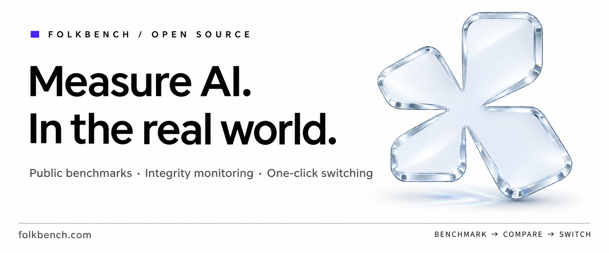
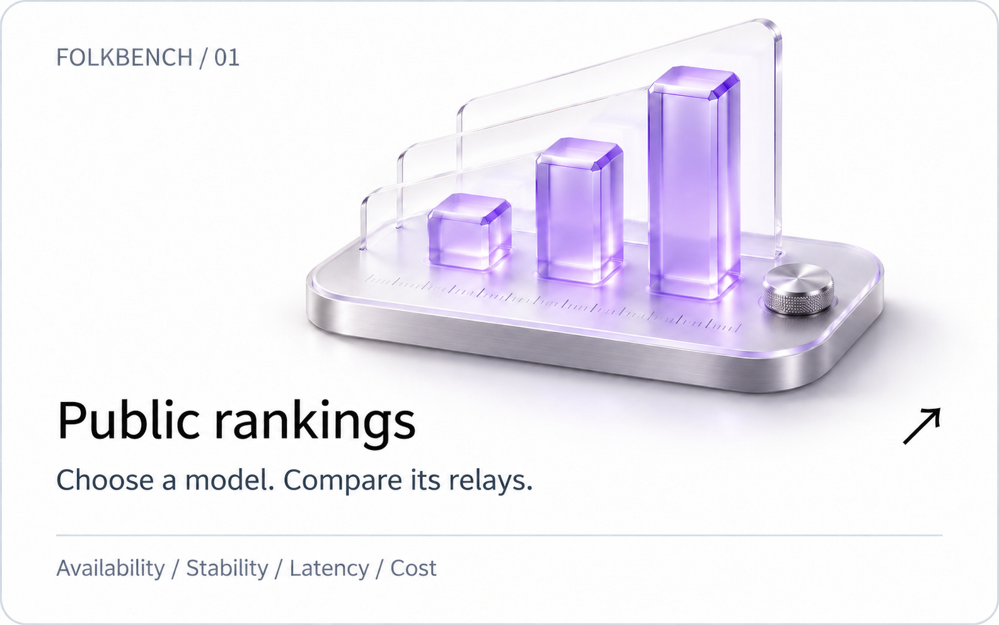
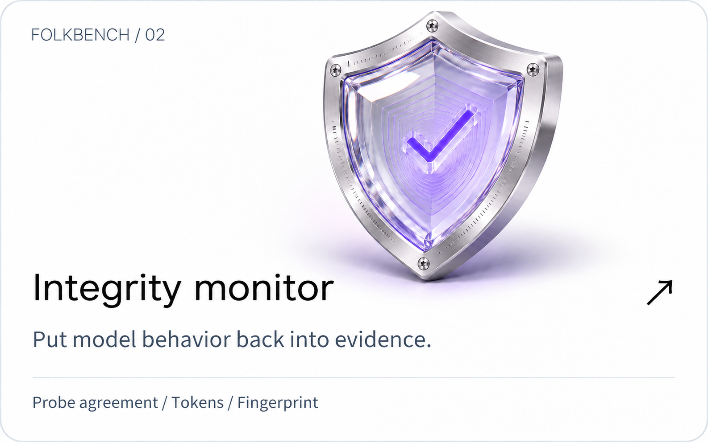
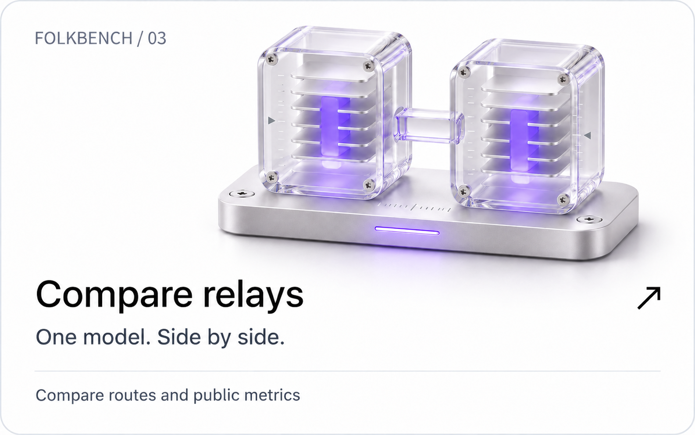
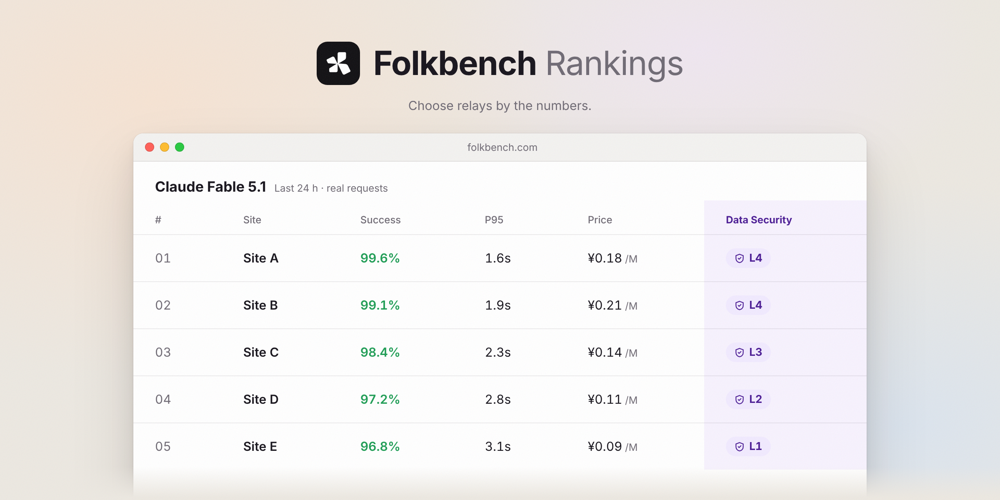
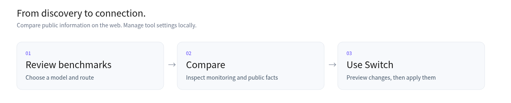
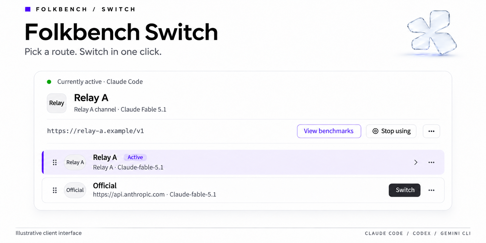

 

**[View rankings](https://folkbench.com/en/rankings?utm_source=github&utm_campaign=readme_en)** · **[Integrity monitor](https://folkbench.com/en/arena?utm_source=github&utm_campaign=readme_en)** · **[Download Switch](https://github.com/Folkbench/folkbench/releases)**

[简体中文](README.md) · [日本語](README.ja.md) · [Español](README.es.md)

 

## Understand the route. Then get to work.

Folkbench brings public AI API relay benchmarks together so you can compare availability, stability, latency and cost for the same model. Once you pick a route, use **Folkbench Switch** to manage connection settings locally for Claude Code, Codex, Gemini CLI and other tools.

This repository contains the **Switch desktop client and blog content**. Public rankings, integrity monitoring and relay comparisons are provided by [folkbench.com](https://folkbench.com/en/?utm_source=github&utm_campaign=readme_en).

## Use public information to answer specific questions

| What matters to you | Start here |
| :--- | :--- |
| Which routes are available more often? | [Availability rankings](https://folkbench.com/en/rankings?utm_source=github&utm_campaign=readme_en) |
| How do routes behave on longer tasks? | [Stability rankings](https://folkbench.com/en/rankings/stability?utm_source=github&utm_campaign=readme_en) |
| Which routes respond faster? | [Latency rankings](https://folkbench.com/en/rankings/latency?utm_source=github&utm_campaign=readme_en) |
| What might a coding session cost? | [Session cost rankings](https://folkbench.com/en/rankings/cost?utm_source=github&utm_campaign=readme_en) |
| Does a model behave consistently across relays? | [Integrity monitor](https://folkbench.com/en/arena?utm_source=github&utm_campaign=readme_en) |
| How do two relays compare? | [Compare relays](https://folkbench.com/en/stations/compare?utm_source=github&utm_campaign=readme_en) |

### Integrity monitoring: inspect differences you can review

Compare probe agreement, input tokens, reasoning tokens and model fingerprints for the same model across routes. Cache measurements are also available where data exists. A single answer or percentage cannot establish model substitution on its own; interpret results alongside the test conditions and samples.

[Open the monitor →](https://folkbench.com/en/arena?utm_source=github&utm_campaign=readme_en) · [Read the methodology →](https://folkbench.com/en/blog/did-the-model-get-dumber?utm_source=github&utm_campaign=readme_en)

<b>Show the illustrative rankings interface</b>

 
<picture>
  <source media="(prefers-color-scheme: dark)" srcset="docs/images/features/board-en-dark.png">
  
</picture>

Existing interface illustration; visit the website for current data and layout.

 

## Folkbench Switch

**Connect the route you choose to the tools you use every day.**

Switch is an open-source desktop client built with Tauri + Rust. Save a provider’s Base URL and API Key, preview the configuration changes, then apply them to your tool. Switch routes or restore the previous configuration when needed.

### Download

<b><a href="https://github.com/Folkbench/folkbench/releases">Download Switch Beta →</a></b> macOS · Apple Silicon / Intel　|　Windows · x64

macOS installers use `.dmg`; Windows installers use `.exe`.

Installers and SHA256 checksums are available in [Releases](https://github.com/Folkbench/folkbench/releases). Follow the instructions for the version you choose.

### Less manual editing when you switch

| Capability | How it works |
| :--- | :--- |
| **Provider switching** | Save connection settings for multiple services and apply your selection to a supported tool. |
| **Configuration previews** | Review changes before writing, preserving other custom settings. Restoration capabilities depend on the tool adapter. |
| **Codex credential protection** | Temporarily park official OAuth credentials when switching to a third-party service and restore them when switching back. |
| **Public route discovery** | Browse routes, availability, status windows and prices from the public catalog in the client. |
| **Local usage estimates** | Review session token usage and estimate cost using reference prices. |

Switch manages tool configuration locally. Online functions such as public catalogs, model queries and provider requests still need a network connection. Website integrity monitoring and cache-compensation information should not be confused with features already integrated into the client.

<b>Supported tools and configuration paths</b>

| Tool | Configuration file / path | Notes |
| :--- | :--- | :--- |
| **Claude Code** | `~/.claude/settings.json` | Writes the Base URL and handles token and API key credential types |
| **Codex** | `~/.codex/config.toml` | Writes a custom provider, parks official credentials and restores them when switching back |
| **Gemini CLI** | `~/.gemini/.env` & `settings.json` | Updates environment variables and authentication settings |
| **Aider** | `~/.aider.conf.yml` | Writes model and API endpoint settings |
| **OpenCode** | `~/.config/opencode/` | Adds service mappings and authentication keys |
| **Kimi CLI** | `~/.kimi-code` / `~/.kimi` | Supports both old and new configuration directories |
| **DeepSeek Harness** | `~/.dsh/` | Adapts the official CLI environment |
| **MiniMax Code / Qwen Code / Grok Build / Hermes / Pi** | — | Adapters remain under active maintenance |

 

## Support Folkbench

These relays support Folkbench's ongoing benchmarks. [Become a sponsor →](https://folkbench.com/vendor/login?utm_source=github&utm_campaign=readme_en)

<!-- 顶级赞助位预留：确定档位后在此放置单独一行大 Logo / Reserved for a top-tier sponsor once tiers exist -->

<!-- /go 跳转上线前的原始链接 / Original links before /go went live:
     Modelflare: https://modelflare.dev/sign-up?partner=TDN1QM6KKYX9&utm_source=folkbench&utm_medium=referral&utm_campaign=folkbench-blog-readme
     CheapAI: https://cheapai.info/sign-up?aff=TkeF&utm_source=folkbench&utm_medium=referral&utm_campaign=folkbench-blog-readme
     IKunCode: https://api.ikuncode.cc/sign-up?aff=QgPu&utm_source=folkbench&utm_medium=referral&utm_campaign=folkbench-blog-readme
     智流 FluxLane: https://folkbench.com/services/fluxlane?utm_source=github&utm_campaign=readme
-->

<table>
<tr>
<td width="200" align="center"><a href="https://folkbench.com/go/modelflare?source=readme_en"><picture><source media="(prefers-color-scheme: dark)" srcset="docs/images/sponsors/modelflare-dark.png"></picture></a></td>
<td><a href="https://folkbench.com/go/modelflare?source=readme_en"><b>Modelflare</b></a> Operated by US-based Havenbyte LLC. Supports major models (GPT, Claude, Gemini, Grok) and standard OpenAI-compatible protocols, alongside 40+ image and video generation models. Features ordered fallback across multiple models per single API Key, secondary pool groups, and comprehensive request audit logs tracking status, latency, tokens, and actual expenditures.  Cache compensation guarantee: Select OpenAI pools guarantee daily cache hit rates of 65% (Price-optimized), 75% (Stable), and 85% (Premium); qualifying requests falling below these thresholds receive compensatory credits. First-time top-ups unlock discounted tiers: a single US$20 deposit unlocks the 0.015-multiplier GPT discount pool (GPT-5.6-Sol at approx. ¥0.51 input / ¥3.01 output per 1M tokens, with no usage cap); a single US$50 deposit unlocks the 0.03-multiplier Claude discount pool.</td>
</tr>
<tr>
<td width="200" align="center"><a href="https://folkbench.com/go/cheapai?source=readme_en"><picture><source media="(prefers-color-scheme: dark)" srcset="docs/images/sponsors/cheapai-dark.png"></picture></a></td>
<td><a href="https://folkbench.com/go/cheapai?source=readme_en"><b>CheapAI</b></a> Focused squarely on budget efficiency, particularly through its discounted pools. Features an innovative dynamic multiplier pool that adjusts rates in real time based on pool capacity—dropping rates when resources are plentiful and balancing cost versus availability during peak periods.  Offers discount tiers for cost-sensitive developers alongside Stable, Pro, and direct Official Key pools to accommodate varying workload criticalities.</td>
</tr>
<tr>
<td width="200" align="center"><a href="https://folkbench.com/go/ikuncode?source=readme_en"><picture><source media="(prefers-color-scheme: dark)" srcset="docs/images/sponsors/ikuncode-dark.png"></picture></a></td>
<td><a href="https://folkbench.com/go/ikuncode?source=readme_en"><b>IKunCode</b></a> Optimized for seamless integration into AI coding CLIs (Claude Code, Codex, Gemini CLI). Provides comprehensive support channels including email, QQ groups, and Telegram with attentive human assistance for beginners.</td>
</tr>
<tr>
<td width="200" align="center"><a href="https://folkbench.com/go/fluxlane?source=readme_en"><picture><source media="(prefers-color-scheme: dark)" srcset="docs/images/sponsors/fluxlane-dark.png"></picture></a></td>
<td><a href="https://folkbench.com/go/fluxlane?source=readme_en"><b>FluxLane (智流)</b></a> An AI API gateway for developers and teams: full-capability, stable access to global models, supporting GPT, Claude, Gemini, DeepSeek, GLM, and other mainstream models as well as major global model-vendor protocols. The platform provides policy-based routing and multi-route failover, making long-term integration and cost accounting easier for teams in China. For enterprise and university procurement in China, it can sign contracts, accept wire transfers, and provide invoices, purchase orders, and related materials (subject to commercial confirmation). Publishes model capability evaluation reports, with multipliers as low as 0.1×, and new registrants receive a $2 trial credit.</td>
</tr>
</table>

---

## Contribute and connect

- **Report a problem:** [Open an issue](https://github.com/Folkbench/folkbench/issues) with reproduction steps and version details. Do not include API keys or configurations containing credentials.
- **Join the discussion:** [Telegram](https://t.me/+C_E8eL1ZevM4MTY9) · [QQ group](https://qm.qq.com/q/71NzSTrPVK) (203286875).
- **Read and contribute:** the [Folkbench blog](https://folkbench.com/en/blog?utm_source=github&utm_campaign=readme_en) covers evaluation methods, model references and reader submissions, with existing content in 12 languages.
- **Develop the client:** [Switch developer notes](apps/switch/README.en.md).

## License

Client code under `apps/switch/` is open source under [Apache-2.0](apps/switch/LICENSE). See [LICENSE.md](LICENSE.md) for blog, image and brand asset licensing. The new README hero, feature cards and Switch showcase are AI-generated promotional illustrations; the workflow is an explanatory diagram. None represents measured results or an original product screenshot.

 <b>Folkbench</b> Measure AI in the real world.  <a href="https://folkbench.com/en/?utm_source=github&amp;utm_campaign=readme_en">Visit the website ↗</a>　·　<a href="https://github.com/Folkbench/folkbench/releases">Download Switch ↗</a>

