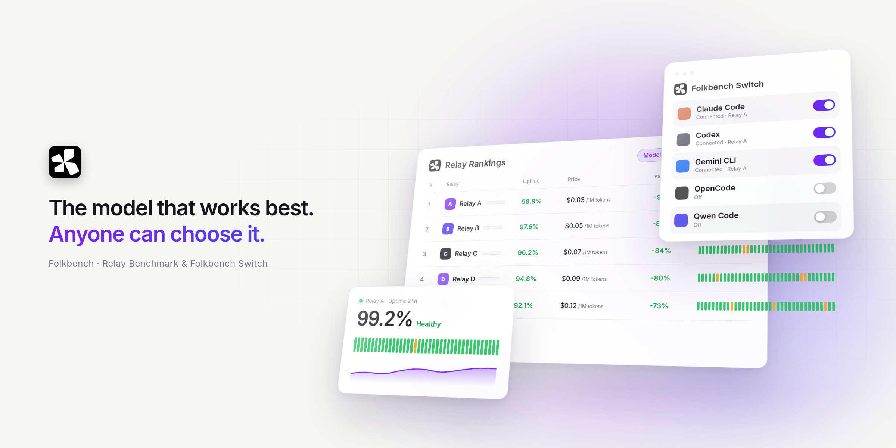
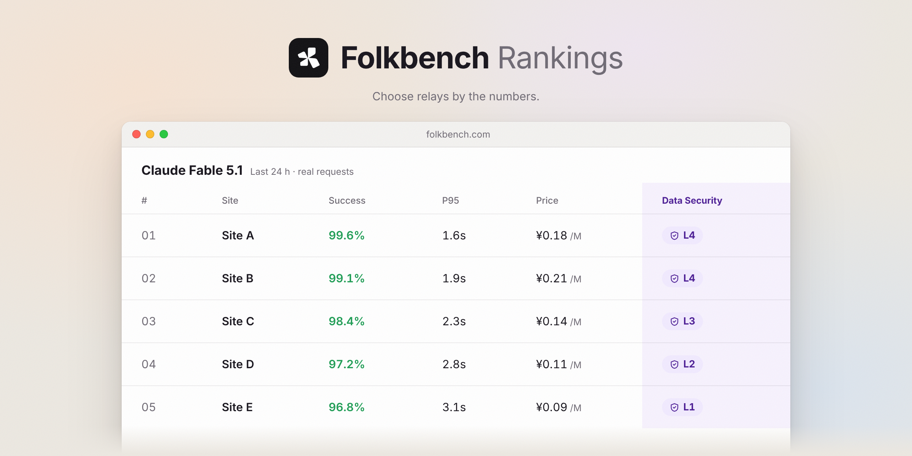
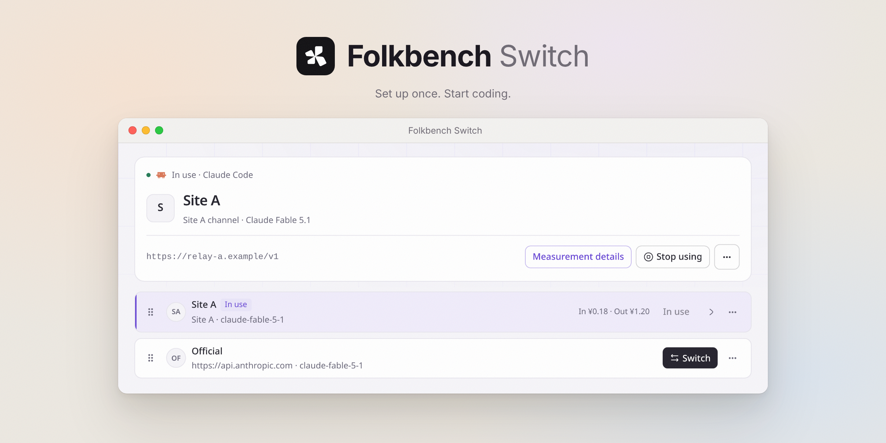
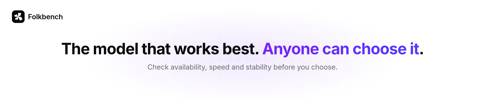

# Folkbench

Mediciones reales de estaciones, y Folkbench Switch.

    

[🌐 Clasificación en vivo](https://folkbench.com/es/rankings/board?utm_source=github&utm_campaign=readme_es) · [⚡ Cliente Switch](#folkbench-switch) · [📦 Descargas](https://github.com/Folkbench/folkbench/releases) · [🔥 Modelos populares](#modelos-populares) · [💬 Comunidad (TG)](https://t.me/+-h3yj4eOYmw0ZTNl) · [💬 Grupo QQ](https://qm.qq.com/q/71NzSTrPVK) · [简体中文](README.md) · [English](README.en.md) · [日本語](README.ja.md)

<picture><source media="(prefers-color-scheme: dark)" srcset="docs/images/hero-en-dark.png"></picture>

 

[folkbench.com](https://folkbench.com/es/?utm_source=github&utm_campaign=readme_es) mide de forma continua las estaciones de API de IA y publica la disponibilidad, el tiempo de respuesta y el precio. Este repositorio contiene el código del cliente de escritorio **Folkbench Switch**, que escribe la ruta elegida en la configuración de Claude Code, Codex y otras herramientas.

---

## Patrocinadores

Estas estaciones apoyan las mediciones continuas de Folkbench. [Hazte patrocinador →](https://folkbench.com/vendor/login?utm_source=github&utm_campaign=readme_es)

<!-- 顶级赞助位预留：确定档位后在此放置单独一行大 Logo / Reserved for a top-tier sponsor once tiers exist -->

<!-- /go 跳转上线前的原始链接 / Original links before /go went live:
     Modelflare: https://modelflare.dev/sign-up?partner=TDN1QM6KKYX9&utm_source=folkbench&utm_medium=referral&utm_campaign=folkbench-blog-readme
     CheapAI: https://cheapai.info/sign-up?aff=TkeF&utm_source=folkbench&utm_medium=referral&utm_campaign=folkbench-blog-readme
     IKunCode: https://api.ikuncode.cc/sign-up?aff=QgPu&utm_source=folkbench&utm_medium=referral&utm_campaign=folkbench-blog-readme
     智流 FluxLane: https://folkbench.com/services/fluxlane?utm_source=github&utm_campaign=readme
-->

<table>
<tr>
<td width="200" align="center"><a href="https://folkbench.com/go/modelflare?source=readme_es"><picture><source media="(prefers-color-scheme: dark)" srcset="docs/images/sponsors/modelflare-dark.png"></picture></a></td>
<td><a href="https://folkbench.com/go/modelflare?source=readme_es"><b>Modelflare</b></a> Modelflare está operado por Havenbyte LLC, en Estados Unidos. Cubre modelos principales como GPT, Claude, Gemini y Grok, además de los protocolos compatibles habituales, y también más de 40 modelos de imagen y vídeo. Una API Key puede configurar un fallback ordenado y llamar a varios modelos; la Key también puede tener un grupo de reserva. En el registro de solicitudes se ven el estado, la latencia, los tokens y el coste real.  La compensación de caché es otro punto de este sitio: algunos grupos de OpenAI —el de precio prioritario, el estable y el premium— garantizan cada día una tasa de aciertos de caché del 65%, el 75% y el 85%, respectivamente. Si una solicitud de API que cumple las condiciones no alcanza esa tasa, la plataforma añade el complemento correspondiente.  Ahora hay una promoción de primera recarga que desbloquea grupos de oferta. Una sola recarga de US$20 desbloquea el grupo de oferta GPT con multiplicador 0.015; después, GPT-5.6-Sol cuesta aproximadamente ¥0.51 (entrada) / ¥3.01 (salida) por millón de tokens, sin límite de uso. Una sola recarga de US$50 desbloquea el grupo de oferta Claude con multiplicador 0.03.</td>
</tr>
<tr>
<td width="200" align="center"><a href="https://folkbench.com/go/cheapai?source=readme_es"><picture><source media="(prefers-color-scheme: dark)" srcset="docs/images/sponsors/cheapai-dark.png"></picture></a></td>
<td><a href="https://folkbench.com/go/cheapai?source=readme_es"><b>CheapAI</b></a> El nombre lo dice: el foco es el precio bajo, sobre todo en el grupo de oferta, donde el precio está muy contenido. También tiene un grupo de multiplicador dinámico. Según el soporte, este grupo ajusta el multiplicador según las cuentas disponibles en ese momento. Cuando hay recursos de sobra, el precio puede bajar más; cuando escasean, se ajusta. El equilibrio entre precio y disponibilidad se hace en tiempo real.  Quien busque relación calidad-precio puede elegir el grupo de oferta, con mejor multiplicador de descuento. Quien busque estabilidad puede elegir el grupo estable o el grupo Pro. El sitio también ofrece un grupo de clave oficial, así que cubre usos distintos.</td>
</tr>
<tr>
<td width="200" align="center"><a href="https://folkbench.com/go/ikuncode?source=readme_es"><picture><source media="(prefers-color-scheme: dark)" srcset="docs/images/sponsors/ikuncode-dark.png"></picture></a></td>
<td><a href="https://folkbench.com/go/ikuncode?source=readme_es"><b>IKunCode</b></a> IKunCode encaja bien con las herramientas de programación: Claude Code, Codex y Gemini CLI tienen soporte propio. Los canales de soporte y consulta están bastante completos; el sitio publica el correo de atención, un grupo de QQ y Telegram. El soporte humano es atento, y sirve para quien empieza.</td>
</tr>
<tr>
<td width="200" align="center"><a href="https://folkbench.com/go/fluxlane?source=readme_es"><picture><source media="(prefers-color-scheme: dark)" srcset="docs/images/sponsors/fluxlane-dark.png"></picture></a></td>
<td><a href="https://folkbench.com/go/fluxlane?source=readme_es"><b>智流 FluxLane</b></a> 智流 FluxLane tiene muchos modelos y rutas, tanto internacionales como de China, y la forma de conexión es uniforme: compatible directamente con el SDK de OpenAI. Además de esa cobertura, la plataforma incluye enrutado, uso, coste y latencia, así que encaja con desarrolladores y equipos que se quedan. Para compras de empresas y universidades tiene una ventaja clara: puede emitir factura, contrato y orden de compra.</td>
</tr>
</table>

---

## Clasificación de estaciones

Hay muchas estaciones. ¿Cuál es estable, cuál es barata y cuál no toca tus datos? La tasa de éxito, la velocidad de respuesta, el precio y el nivel de seguridad de datos se ven en una sola clasificación. [General](https://folkbench.com/es/rankings/board?utm_source=github&utm_campaign=readme_es) · [Estabilidad](https://folkbench.com/es/rankings/board?metric=availability&utm_source=github&utm_campaign=readme_es) · [Relación calidad-precio](https://folkbench.com/es/rankings/board?metric=price&utm_source=github&utm_campaign=readme_es).

<picture>
  <source media="(prefers-color-scheme: dark)" srcset="docs/images/features/board-en-dark.png">
  
</picture>

### Modelos populares

Si quieres ver cómo se comporta un modelo concreto en cada estación, abre su clasificación:

| Modelo | Datos medidos |
| :--- | :--- |
| **GPT 6 Sol** | [Ver los datos medidos de cada estación](https://folkbench.com/es/rankings/gpt-6-sol?utm_source=github&utm_medium=readme&utm_campaign=readme_es) |
| **GPT 6 Astra** | [Ver los datos medidos de cada estación](https://folkbench.com/es/rankings/gpt-6-astra?utm_source=github&utm_medium=readme&utm_campaign=readme_es) |
| **Claude Fable 5.1** | [Ver los datos medidos de cada estación](https://folkbench.com/es/rankings/claude-fable-5-1?utm_source=github&utm_medium=readme&utm_campaign=readme_es) |
| **Grok 4.7** | [Ver los datos medidos de cada estación](https://folkbench.com/es/rankings/grok-4-7?utm_source=github&utm_medium=readme&utm_campaign=readme_es) |
| **DeepSeek V4.1 Flash** | [Ver los datos medidos de cada estación](https://folkbench.com/es/rankings/deepseek-v4-1-flash?utm_source=github&utm_medium=readme&utm_campaign=readme_es) |

## Folkbench Switch

Una herramienta de configuración para asistentes de programación con IA, pensada para quien empieza. Claude Code, Codex, Gemini CLI y otros quedan listos en un clic, y es fácil de usar. [Descargar para macOS / Windows](https://github.com/Folkbench/folkbench/releases).

macOS: Apple Silicon / Intel (`.dmg`); Windows: x64 (`.exe`). Los instaladores y los archivos de comprobación SHA256 se descargan en [Releases](https://github.com/Folkbench/folkbench/releases).

<picture>
  <source media="(prefers-color-scheme: dark)" srcset="docs/images/features/switch-en-dark.png">
  
</picture>

Switch es el cliente de escritorio de código abierto que acompaña a Folkbench, construido con Tauri y Rust. Su valor principal es este: **cambiar con un clic el Base URL y la API Key entre varias estaciones y la ruta oficial, sin volver a editar la configuración a mano.**

### 🎯 Funciones principales

- 🔄 **Cambio de proveedor en un clic**: guarda el Base URL y la API Key de varios servicios y aplícalos a la herramienta de destino. Se puede cambiar y volver atrás cuando haga falta.
- 🛡️ **Configuración sin pérdida y protección de estado**: antes de aplicar, muestra la diferencia. Al pasar Codex a un servicio de terceros, guarda de forma segura la credencial OAuth oficial de ChatGPT y la restaura sin pérdida al volver a la ruta oficial.
- 📈 **Datos de sonda integrados**: dentro del cliente se ven la disponibilidad pública en tiempo real y la latencia de cada sitio, para confirmar la ruta antes de cambiar.
- 🔒 **Almacenamiento local y privacidad**: todas las API Keys y la configuración se quedan en el dispositivo. No se suben a la nube y el cliente funciona sin conexión.
- 📊 **Estimación de uso local**: cuenta los tokens por sesión y estima el coste con los precios de referencia públicos.

### 🧰 Herramientas compatibles

Switch adapta la ruta y los campos de cada herramienta. Al cambiar, solo cubre los parámetros de conexión y conserva el resto de ajustes propios:

| Herramienta | Archivo / ruta | Notas |
| :--- | :--- | :--- |
| **Claude Code** | `~/.claude/settings.json` | Escribe el Base URL y distingue el tipo de credencial entre token y API Key |
| **Codex** | `~/.codex/config.toml` | Escribe el provider personalizado, guarda la credencial oficial y la restaura al volver |
| **Gemini CLI** | `~/.gemini/.env` & `settings.json` | Escribe a la vez las variables de entorno y el método de autenticación |
| **Aider** | `~/.aider.conf.yml` | Escribe el modelo y los parámetros del endpoint de la API |
| **OpenCode** | `~/.config/opencode/` | Inyecta el mapa de servicios y la clave de autenticación |
| **Kimi CLI** | `~/.kimi-code` / `~/.kimi` | Compatible con los directorios de la versión nueva y de la antigua |
| **DeepSeek Harness** | `~/.dsh/` | Adaptado al entorno de la CLI oficial |
| **Otras** | MiniMax Code, Qwen Code, Grok Build, Hermes, Pi, etc. | Se sigue manteniendo la compatibilidad |

---

## Comunidad

Los errores y las ideas de funciones van a [GitHub Issues](https://github.com/Folkbench/folkbench/issues). También puedes entrar en [Telegram](https://t.me/+-h3yj4eOYmw0ZTNl) o en el [grupo de QQ](https://qm.qq.com/q/71NzSTrPVK) (203286875).

## Licencia

El código de Switch en `apps/switch/` se publica bajo [Apache-2.0](apps/switch/LICENSE). Los artículos del blog, las imágenes y los materiales de marca quedan fuera; los detalles están en [LICENSE.md](LICENSE.md).

<picture><source media="(prefers-color-scheme: dark)" srcset="docs/images/banner-en-dark.png"></picture>

