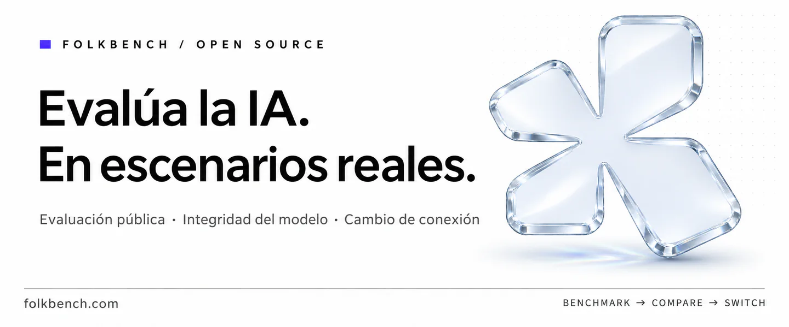
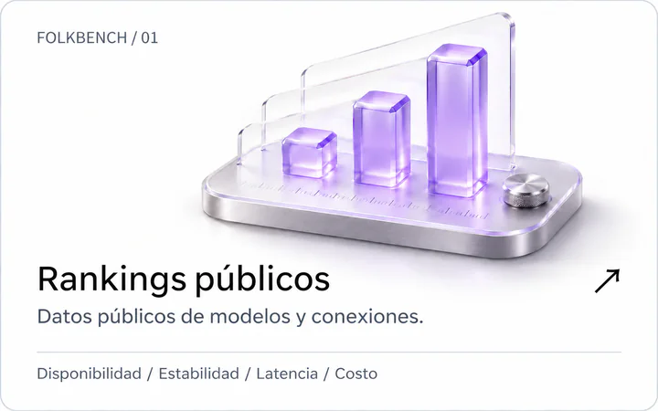
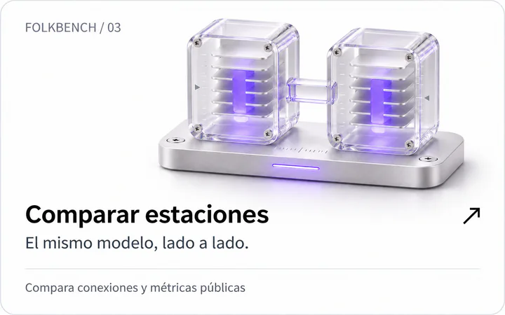
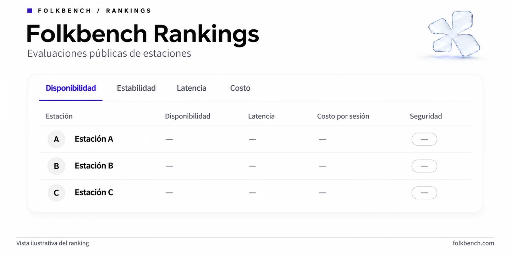
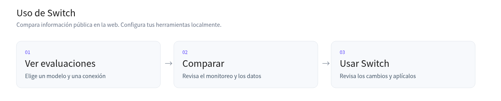
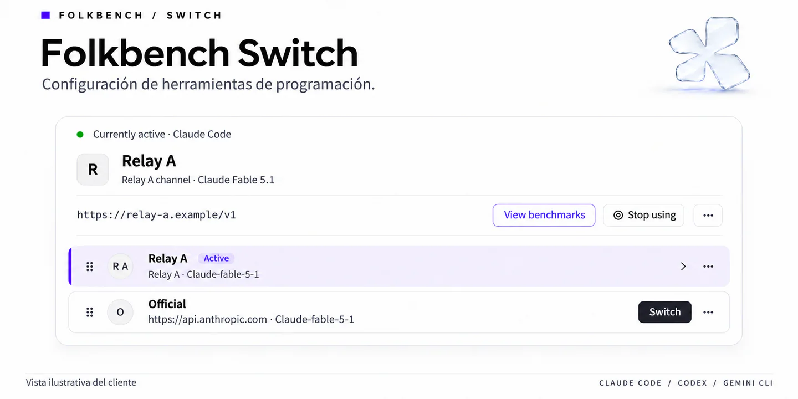

 

**[Ver rankings](https://folkbench.com/es/rankings?utm_source=github&utm_campaign=readme_es)** · **[Integridad del modelo](https://folkbench.com/es/arena?utm_source=github&utm_campaign=readme_es)** · **[Descargar Switch](https://github.com/Folkbench/folkbench/releases)**

[简体中文](README.md) · [English](README.en.md) · [日本語](README.ja.md)

 

## Patrocinadores

Estas estaciones apoyan las mediciones continuas de Folkbench. [Hazte patrocinador →](https://folkbench.com/vendor/login?utm_source=github&utm_campaign=readme_es)

<!-- 顶级赞助位预留：确定档位后在此放置单独一行大 Logo / Reserved for a top-tier sponsor once tiers exist -->

<!-- /go 跳转上线前的原始链接 / Original links before /go went live:
     Modelflare: https://modelflare.dev/sign-up?partner=TDN1QM6KKYX9&utm_source=folkbench&utm_medium=referral&utm_campaign=folkbench-blog-readme
     CheapAI: https://cheapai.info/sign-up?aff=TkeF&utm_source=folkbench&utm_medium=referral&utm_campaign=folkbench-blog-readme
     IKunCode: https://api.ikuncode.cc/sign-up?aff=QgPu&utm_source=folkbench&utm_medium=referral&utm_campaign=folkbench-blog-readme
     智流 FluxLane: https://folkbench.com/services/fluxlane?utm_source=github&utm_campaign=readme
-->

<table>
<tr>
<td width="200" align="center"><a href="https://folkbench.com/go/modelflare?source=readme_es"><picture><source media="(prefers-color-scheme: dark)" srcset="docs/images/sponsors/modelflare-dark.png"></picture></a></td>
<td><a href="https://folkbench.com/go/modelflare?source=readme_es"><b>Modelflare</b></a> Modelflare está operado por Havenbyte LLC, en Estados Unidos. Cubre modelos principales como GPT, Claude, Gemini y Grok, además de los protocolos compatibles habituales, y también más de 40 modelos de imagen y vídeo. Una API Key puede configurar un fallback ordenado y llamar a varios modelos; la Key también puede tener un grupo de reserva. En el registro de solicitudes se ven el estado, la latencia, los tokens y el coste real.  La compensación de caché es otro punto de este sitio: algunos grupos de OpenAI —el de precio prioritario, el estable y el premium— garantizan cada día una tasa de aciertos de caché del 65%, el 75% y el 85%, respectivamente. Si una solicitud de API que cumple las condiciones no alcanza esa tasa, la plataforma añade el complemento correspondiente.  Ahora hay una promoción de primera recarga que desbloquea grupos de oferta. Una sola recarga de US$20 desbloquea el grupo de oferta GPT con multiplicador 0.015; después, GPT-5.6-Sol cuesta aproximadamente ¥0.51 (entrada) / ¥3.01 (salida) por millón de tokens, sin límite de uso. Una sola recarga de US$50 desbloquea el grupo de oferta Claude con multiplicador 0.03.</td>
</tr>
<tr>
<td width="200" align="center"><a href="https://folkbench.com/go/cheapai?source=readme_es"><picture><source media="(prefers-color-scheme: dark)" srcset="docs/images/sponsors/cheapai-dark.png"></picture></a></td>
<td><a href="https://folkbench.com/go/cheapai?source=readme_es"><b>CheapAI</b></a> El nombre lo dice: el foco es el precio bajo, sobre todo en el grupo de oferta, donde el precio está muy contenido. También tiene un grupo de multiplicador dinámico. Según el soporte, este grupo ajusta el multiplicador según las cuentas disponibles en ese momento. Cuando hay recursos de sobra, el precio puede bajar más; cuando escasean, se ajusta. El equilibrio entre precio y disponibilidad se hace en tiempo real.  Quien busque relación calidad-precio puede elegir el grupo de oferta, con mejor multiplicador de descuento. Quien busque estabilidad puede elegir el grupo estable o el grupo Pro. El sitio también ofrece un grupo de clave oficial, así que cubre usos distintos.</td>
</tr>
<tr>
<td width="200" align="center"><a href="https://folkbench.com/go/ikuncode?source=readme_es"><picture><source media="(prefers-color-scheme: dark)" srcset="docs/images/sponsors/ikuncode-dark.png"></picture></a></td>
<td><a href="https://folkbench.com/go/ikuncode?source=readme_es"><b>IKunCode</b></a> IKunCode encaja bien con las herramientas de programación: Claude Code, Codex y Gemini CLI tienen soporte propio. Los canales de soporte y consulta están bastante completos; el sitio publica el correo de atención, un grupo de QQ y Telegram. El soporte humano es atento, y sirve para quien empieza.</td>
</tr>
<tr>
<td width="200" align="center"><a href="https://folkbench.com/go/fluxlane?source=readme_es"><picture><source media="(prefers-color-scheme: dark)" srcset="docs/images/sponsors/fluxlane-dark.png"></picture></a></td>
<td><a href="https://folkbench.com/go/fluxlane?source=readme_es"><b>智流 FluxLane</b></a> 智流 FluxLane tiene muchos modelos y rutas, tanto internacionales como de China, y la forma de conexión es uniforme: compatible directamente con el SDK de OpenAI. Además de esa cobertura, la plataforma incluye enrutado, uso, coste y latencia, así que encaja con desarrolladores y equipos que se quedan. Para compras de empresas y universidades tiene una ventaja clara: puede emitir factura, contrato y orden de compra.</td>
</tr>
</table>

---

## Folkbench

Folkbench reúne evaluaciones públicas de estaciones de API de IA para comparar disponibilidad, estabilidad, latencia y costo de un mismo modelo. Una vez elegida la conexión, usa **Folkbench Switch** para administrar localmente la configuración de Claude Code, Codex, Gemini CLI y otras herramientas.

<table width="100%">
<tr>
<td width="33%" align="center" valign="top"></td>
<td width="33%" align="center" valign="top"></td>
<td width="33%" align="center" valign="top"></td>
</tr>
</table>

## Evaluaciones

| Qué te interesa | Por dónde empezar |
| :--- | :--- |
| ¿Qué conexiones están disponibles con mayor frecuencia? | [Ranking de disponibilidad](https://folkbench.com/es/rankings?utm_source=github&utm_campaign=readme_es) |
| ¿Cómo se comportan en tareas largas? | [Ranking de estabilidad](https://folkbench.com/es/rankings/stability?utm_source=github&utm_campaign=readme_es) |
| ¿Qué conexiones responden más rápido? | [Ranking de latencia](https://folkbench.com/es/rankings/latency?utm_source=github&utm_campaign=readme_es) |
| ¿Cuánto podría costar una sesión de programación? | [Ranking de costo por sesión](https://folkbench.com/es/rankings/cost?utm_source=github&utm_campaign=readme_es) |
| ¿Un modelo se comporta igual en distintas estaciones? | [Integridad del modelo](https://folkbench.com/es/arena?utm_source=github&utm_campaign=readme_es) |
| ¿Cómo se comparan dos estaciones? | [Comparar estaciones](https://folkbench.com/es/stations/compare?utm_source=github&utm_campaign=readme_es) |

### Integridad del modelo

Compara la concordancia de respuestas a preguntas de identidad, los tokens de entrada, los tokens de razonamiento y la huella del modelo entre conexiones del mismo modelo. También puedes consultar mediciones de caché cuando hay datos. Una sola respuesta o un porcentaje no demuestran por sí solos que un modelo haya sido sustituido: interpreta los resultados junto con las condiciones y las muestras de la prueba.

[Abrir el monitor →](https://folkbench.com/es/arena?utm_source=github&utm_campaign=readme_es) · [Leer la metodología →](https://folkbench.com/es/blog/did-the-model-get-dumber?utm_source=github&utm_campaign=readme_es)

<b>Folkbench Rankings</b>

 

Datos de ejemplo. Consulta los resultados publicados en el sitio.

 

## Folkbench Switch

**Conecta la estación que elegiste con las herramientas que usas a diario.**

Switch es un cliente de escritorio de código abierto construido con Tauri + Rust. Guarda la Base URL y la API Key de un proveedor, revisa los cambios de configuración y aplícalos a tu herramienta. Cuando lo necesites, cambia de conexión o restaura la configuración anterior.

### Descargas

<b><a href="https://github.com/Folkbench/folkbench/releases">Descargar Switch Beta →</a></b> macOS · Apple Silicon / Intel　|　Windows · x64

Los instaladores de macOS usan `.dmg`; los de Windows usan `.exe`.

Los instaladores y archivos de verificación SHA256 están en [Releases](https://github.com/Folkbench/folkbench/releases). Sigue las instrucciones de la versión que elijas.

### Funciones

| Función | Cómo funciona |
| :--- | :--- |
| **Cambio de proveedor** | Guarda la configuración de varios servicios y aplica tu elección a una herramienta compatible. |
| **Vista previa de cambios** | Revisa los cambios antes de escribirlos y conserva otros ajustes personalizados. La restauración depende del adaptador de cada herramienta. |
| **Protección de credenciales de Codex** | Al cambiar a un tercero, guarda temporalmente las credenciales OAuth oficiales y las restaura al volver. |
| **Descubrimiento de conexiones públicas** | Consulta conexiones, disponibilidad, ventanas de estado y precios del catálogo público dentro del cliente. |
| **Estimación de uso local** | Revisa los tokens por sesión y estima el costo con precios de referencia. |

Switch administra localmente la configuración de las herramientas. Las funciones en línea, como el catálogo público, las consultas de modelos y las solicitudes a proveedores, requieren conexión a internet. El monitoreo de integridad y la información de compensación de caché del sitio no implican que esas funciones ya estén integradas en el cliente. La interfaz de Switch está disponible en chino e inglés; la ilustración de esta página muestra la versión en inglés.

<b>Herramientas compatibles y rutas de configuración</b>

| Herramienta | Archivo / ruta de configuración | Notas |
| :--- | :--- | :--- |
| **Claude Code** | `~/.claude/settings.json` | Escribe la Base URL y gestiona los tipos de credenciales token y API Key |
| **Codex** | `~/.codex/config.toml` | Escribe un proveedor personalizado, guarda las credenciales oficiales y las restaura al volver |
| **Gemini CLI** | `~/.gemini/.env` & `settings.json` | Actualiza las variables de entorno y el método de autenticación |
| **Aider** | `~/.aider.conf.yml` | Escribe el modelo y el endpoint de la API |
| **OpenCode** | `~/.config/opencode/` | Añade asignaciones de servicios y claves de autenticación |
| **Kimi CLI** | `~/.kimi-code` / `~/.kimi` | Admite directorios de configuración nuevos y anteriores |
| **DeepSeek Harness** | `~/.dsh/` | Adapta el entorno de la CLI oficial |
| **MiniMax Code / Qwen Code / Grok Build / Hermes / Pi** | — | Los adaptadores siguen en mantenimiento activo |

---

## Comunidad

- **Reporta un problema:** [abre un issue](https://github.com/Folkbench/folkbench/issues) con pasos para reproducirlo y la versión. No incluyas API Keys ni configuraciones con credenciales.
- **Únete a la conversación:** [Telegram](https://t.me/+C_E8eL1ZevM4MTY9) · [grupo QQ](https://qm.qq.com/q/71NzSTrPVK) (203286875).
- **Lee y contribuye:** el [blog de Folkbench](https://folkbench.com/es/blog?utm_source=github&utm_campaign=readme_es) incluye métodos de evaluación, referencias de modelos y aportes de lectores, con contenido existente en 12 idiomas.
- **Desarrollo del cliente:** [notas de desarrollo de Switch, en inglés](apps/switch/README.en.md).

## Licencia

El código del cliente en `apps/switch/` se publica bajo [Apache-2.0](apps/switch/LICENSE). Consulta [LICENSE.md](LICENSE.md) para el alcance de las licencias de artículos, imágenes y recursos de marca.

 <b>Folkbench</b> Evalúa la IA en escenarios reales.  <a href="https://folkbench.com/es/?utm_source=github&amp;utm_campaign=readme_es">Visita el sitio ↗</a>　·　<a href="https://github.com/Folkbench/folkbench/releases">Descarga Switch ↗</a>

