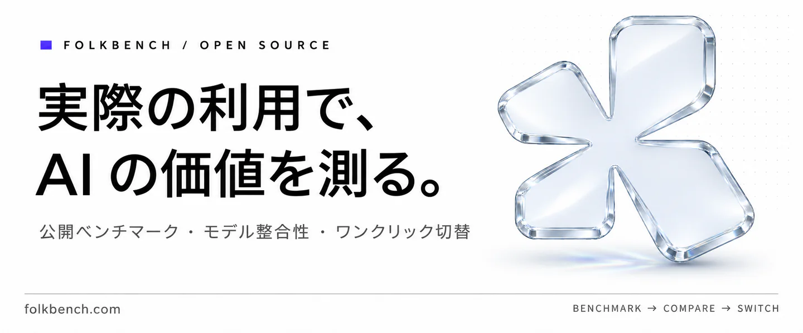
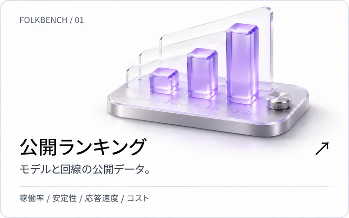
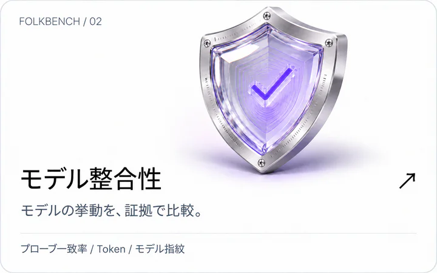
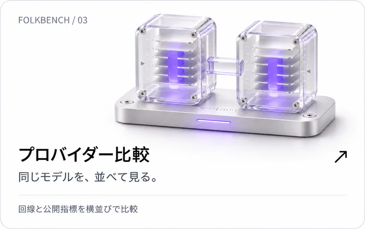
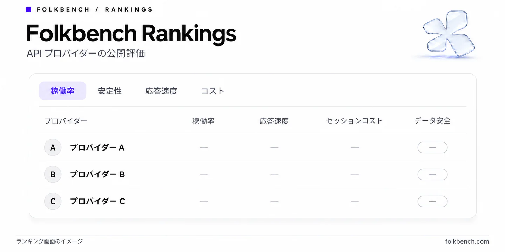
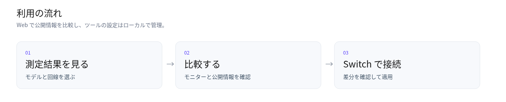
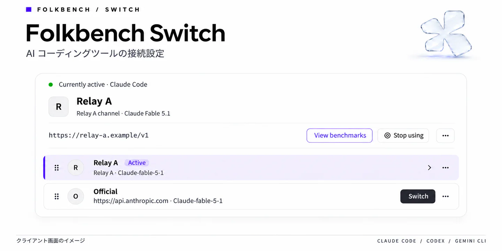

 

**[ランキングを見る](https://folkbench.com/ja/rankings?utm_source=github&utm_campaign=readme_ja)** · **[モデル整合性](https://folkbench.com/ja/arena?utm_source=github&utm_campaign=readme_ja)** · **[Switch をダウンロード](https://github.com/Folkbench/folkbench/releases)**

[简体中文](README.md) · [English](README.en.md) · [Español](README.es.md)

 

## Folkbench

Folkbench は AI API プロバイダーの公開ベンチマークを集約し、同じモデルの稼働率・安定性・応答速度・コストを比較できるようにします。回線を選んだら、**Folkbench Switch** で Claude Code、Codex、Gemini CLI などの接続設定をローカルで管理できます。

<table width="100%">
<tr>
<td width="33%" align="center" valign="top"></td>
<td width="33%" align="center" valign="top"></td>
<td width="33%" align="center" valign="top"></td>
</tr>
</table>

## ベンチマーク

| 知りたいこと | 確認するページ |
| :--- | :--- |
| 利用できることが多い回線は？ | [稼働率ランキング](https://folkbench.com/ja/rankings?utm_source=github&utm_campaign=readme_ja) |
| 長時間のタスクでの挙動は？ | [安定性ランキング](https://folkbench.com/ja/rankings/stability?utm_source=github&utm_campaign=readme_ja) |
| 応答が速い回線は？ | [応答速度ランキング](https://folkbench.com/ja/rankings/latency?utm_source=github&utm_campaign=readme_ja) |
| コーディングセッションの費用の目安は？ | [セッションコストランキング](https://folkbench.com/ja/rankings/cost?utm_source=github&utm_campaign=readme_ja) |
| 同じモデルでもプロバイダーによって挙動が違う？ | [モデル整合性モニター](https://folkbench.com/ja/arena?utm_source=github&utm_campaign=readme_ja) |
| 二つのプロバイダーを比較したい | [プロバイダー比較](https://folkbench.com/ja/stations/compare?utm_source=github&utm_campaign=readme_ja) |

### モデル整合性

同じモデルの異なる回線について、モデルの識別情報を問うプローブへの回答一致率、入力 Token、推論 Token、モデル指紋を確認できます。データがある場合はキャッシュ測定情報も表示されます。一つの回答や一つの割合だけでモデルのすり替えを断定することはできません。テスト条件とサンプルを合わせて結果を解釈してください。

[モニターを開く →](https://folkbench.com/ja/arena?utm_source=github&utm_campaign=readme_ja) · [評価方法を読む →](https://folkbench.com/ja/blog/did-the-model-get-dumber?utm_source=github&utm_campaign=readme_ja)

<b>Folkbench Rankings</b>

 

画面イメージです。最新のデータは Web サイトでご確認ください。

 

## Folkbench Switch

**選んだ回線を、毎日使うツールへ。**

Switch は Tauri + Rust で開発されたオープンソースのデスクトップクライアントです。プロバイダーの Base URL と API Key を保存し、設定差分を確認してから対象ツールへ適用します。必要に応じて回線を切り替えたり、以前の設定を復元したりできます。

### ダウンロード

<b><a href="https://github.com/Folkbench/folkbench/releases">Switch Beta をダウンロード →</a></b> macOS · Apple Silicon / Intel　｜　Windows · x64

macOS のインストーラーは `.dmg`、Windows は `.exe` 形式です。

インストーラーと SHA256 チェックサムは [Releases](https://github.com/Folkbench/folkbench/releases) に掲載しています。利用するバージョンのリリースノートに従ってください。

### 機能

| 機能 | できること |
| :--- | :--- |
| **プロバイダーの切替** | 複数サービスの接続設定を保存し、選択した設定を対応ツールへ適用します。 |
| **設定差分の確認** | 書き込み前に変更を確認し、ほかのカスタム設定を保持します。復元できる範囲はツールのアダプターによって異なります。 |
| **Codex の認証情報保護** | サードパーティーへ切り替える際に公式 OAuth 認証情報を一時退避し、公式に戻すときに復元します。 |
| **公開回線の検索** | 公開カタログの回線、稼働率、状態履歴、価格をクライアントで確認できます。 |
| **ローカル使用量の推計** | セッションごとの Token 使用量を確認し、参考単価でコストを推計します。 |

Switch はツールの設定をローカルで管理します。公開カタログの取得、モデル情報の照会、プロバイダーへのリクエストなどにはネットワーク接続が必要です。Web サイトのモデル整合性モニターやキャッシュ補償情報が、そのままクライアントに実装されているわけではありません。Switch の UI は中国語と英語に対応しており、このページのクライアント画面イメージは英語表示です。

<b>対応ツールと設定パス</b>

| ツール | 設定ファイル / パス | 内容 |
| :--- | :--- | :--- |
| **Claude Code** | `~/.claude/settings.json` | Base URL を書き込み、トークンと API Key の認証形式を処理 |
| **Codex** | `~/.codex/config.toml` | カスタムプロバイダーを設定し、公式認証情報を退避・復元 |
| **Gemini CLI** | `~/.gemini/.env` & `settings.json` | 環境変数と認証方式を更新 |
| **Aider** | `~/.aider.conf.yml` | モデルと API エンドポイントを設定 |
| **OpenCode** | `~/.config/opencode/` | サービスの割り当てと認証キーを設定 |
| **Kimi CLI** | `~/.kimi-code` / `~/.kimi` | 新旧の設定ディレクトリに対応 |
| **DeepSeek Harness** | `~/.dsh/` | 公式 CLI の環境に対応 |
| **MiniMax Code / Qwen Code / Grok Build / Hermes / Pi** | — | 各アダプターは継続的に保守中 |

 

## スポンサー

<table>
<tr>
<td width="200" align="center"><a href="https://folkbench.com/go/modelflare?source=readme_ja"><picture><source media="(prefers-color-scheme: dark)" srcset="docs/images/sponsors/modelflare-dark.png"></picture></a></td>
<td><a href="https://folkbench.com/go/modelflare?source=readme_ja"><b>Modelflare</b></a> 米国の Havenbyte LLC が運営。GPT、Claude、Gemini、Grok などの主要モデルと標準互換プロトコルに対応し、40種以上の画像・動画生成モデルもカバー。単一の API Key で複数モデルのフォールバック制御や予備グループの設定が可能で、リクエストログから遅延や実消費コストを確認できます。  キャッシュ補償制度も特徴で、対象の OpenAI プールでキャッシュヒット率保証（65%〜85%）を下回った場合に補填が行われます。初回チャージ特典として、単発 US$20 のチャージで倍率 0.015 の GPT 特恵グループが解放されます。解放後の GPT-5.6-Sol は 100 万トークンあたりおよそ入力 ¥0.51 / 出力 ¥3.01 で、利用上限はありません。単発 US$50 のチャージで倍率 0.03 の Claude 特恵グループが解放されます。</td>
</tr>
<tr>
<td width="200" align="center"><a href="https://folkbench.com/go/cheapai?source=readme_ja"><picture><source media="(prefers-color-scheme: dark)" srcset="docs/images/sponsors/cheapai-dark.png"></picture></a></td>
<td><a href="https://folkbench.com/go/cheapai?source=readme_ja"><b>CheapAI</b></a> 圧倒的な低価格を重視したサービス。リアルタイムの回線状況に応じて倍率を自動調整する「動的倍率プール」を備え、リソースに余裕がある時間帯はさらに安価に利用可能です。  コストを最優先するユーザー向けの割引プールから、安定性重視の Pro プール、公式 Key プールまで幅広い選択肢を提供しています。</td>
</tr>
<tr>
<td width="200" align="center"><a href="https://folkbench.com/go/ikuncode?source=readme_ja"><picture><source media="(prefers-color-scheme: dark)" srcset="docs/images/sponsors/ikuncode-dark.png"></picture></a></td>
<td><a href="https://folkbench.com/go/ikuncode?source=readme_ja"><b>IKunCode</b></a> Claude Code、Codex、Gemini CLI などのコーディング支援ツールの導入サポートが充実。メール、QQ、Telegram などの窓口を公開しており、導入初心者に親切なサポート体制を整えています。</td>
</tr>
<tr>
<td width="200" align="center"><a href="https://folkbench.com/go/fluxlane?source=readme_ja"><picture><source media="(prefers-color-scheme: dark)" srcset="docs/images/sponsors/fluxlane-dark.png"></picture></a></td>
<td><a href="https://folkbench.com/go/fluxlane?source=readme_ja"><b>FluxLane（智流）</b></a> 国内外の多様なモデルを網羅し、OpenAI SDK と完全互換。ルーティング、利用量、コスト、遅延を一元管理でき、企業や教育機関向けの請求書・契約書対応が強みです。</td>
</tr>
</table>

---

## コミュニティ

- **不具合の報告：** 再現手順とバージョンを添えて [Issue](https://github.com/Folkbench/folkbench/issues) を作成してください。API Key や認証情報を含む設定は投稿しないでください。
- **コミュニティ：** [Telegram](https://t.me/+C_E8eL1ZevM4MTY9) · [QQ グループ](https://qm.qq.com/q/71NzSTrPVK)（203286875）。
- **記事と投稿：** [Folkbench ブログ](https://folkbench.com/ja/blog?utm_source=github&utm_campaign=readme_ja) では評価方法、モデル資料、読者投稿を扱っています。既存の記事は 12 言語で提供しています。
- **クライアント開発：** [Switch 開発ガイド（英語）](apps/switch/README.en.md)。

## ライセンス

`apps/switch/` のクライアントコードは [Apache-2.0](apps/switch/LICENSE) で公開しています。ブログ記事、画像、ブランド素材の利用範囲は [LICENSE.md](LICENSE.md) を参照してください。

 <b>Folkbench</b> 実際の利用で、AI の価値を測る。  <a href="https://folkbench.com/ja/?utm_source=github&amp;utm_campaign=readme_ja">Web サイトへ ↗</a>　·　<a href="https://github.com/Folkbench/folkbench/releases">Switch をダウンロード ↗</a>

