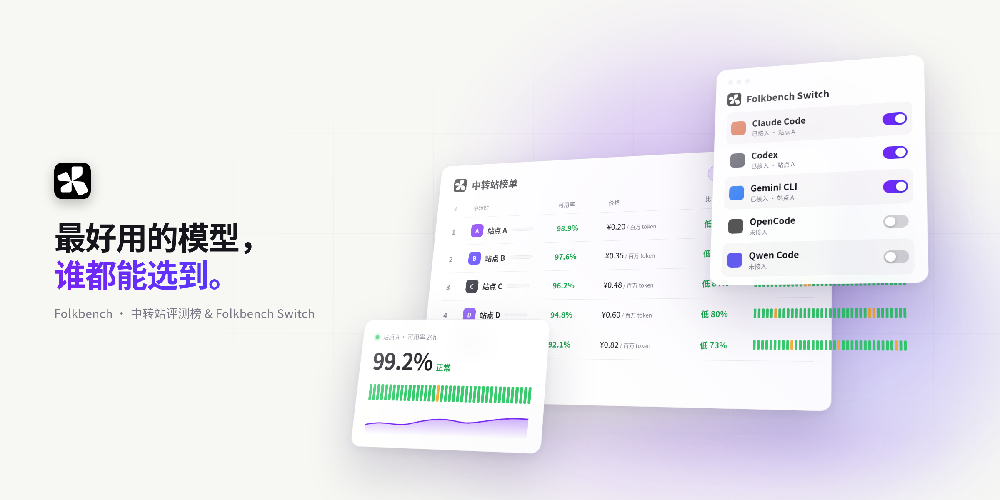
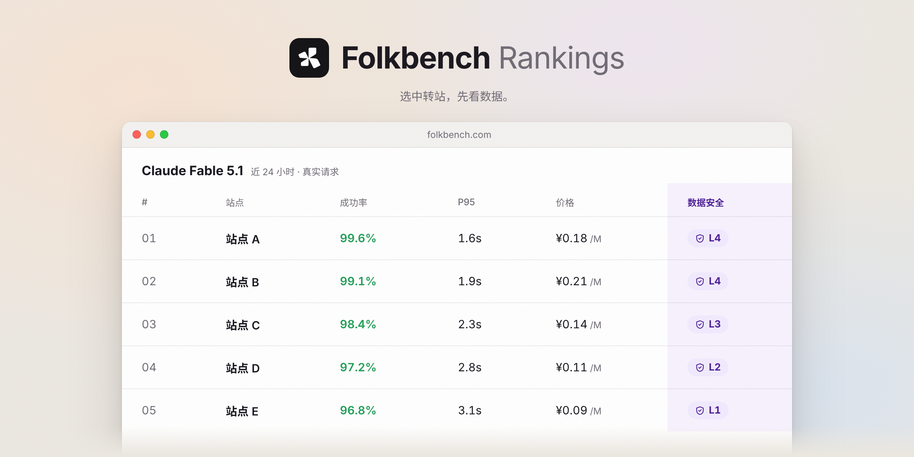
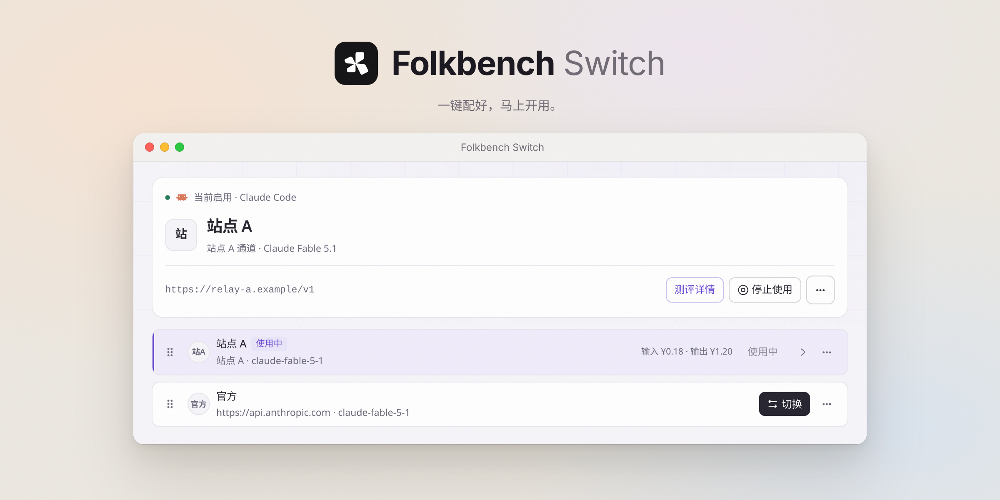

# Folkbench

中转站实测评测，与 Folkbench Switch。

    

[🌐 在线评测大盘](https://folkbench.com/rankings/board?utm_source=github&utm_campaign=readme) · [⚡ Switch 客户端](#folkbench-switch) · [📦 下载安装](https://github.com/Folkbench/folkbench/releases) · [🔥 热门模型](#热门模型) · [💬 交流群 (TG)](https://t.me/+-h3yj4eOYmw0ZTNl) · [💬 QQ 群](https://qm.qq.com/q/71NzSTrPVK) · [English](README.en.md) · [日本語](README.ja.md) · [Español](README.es.md)

<picture>
  <source media="(prefers-color-scheme: dark)" srcset="docs/images/hero-dark.png">
  
</picture>

 

[folkbench.com](https://folkbench.com/?utm_source=github&utm_campaign=readme) 持续测试各家 AI 中转站，公开可用率、响应耗时和价格。本仓库是配套桌面客户端 **Folkbench Switch** 的代码，用来把选好的线路写入 Claude Code、Codex 等工具的配置。

---

## 中转站榜单

中转站那么多，哪家稳、哪家便宜、哪家不碰你的数据？成功率、响应速度、价格和数据安全等级，一张榜单看清。[总榜](https://folkbench.com/rankings/board?utm_source=github&utm_campaign=readme) · [稳定性榜](https://folkbench.com/rankings/board?metric=availability&utm_source=github&utm_campaign=readme) · [性价比榜](https://folkbench.com/rankings/board?metric=price&utm_source=github&utm_campaign=readme)。

<picture>
  <source media="(prefers-color-scheme: dark)" srcset="docs/images/features/board-dark.png">
  
</picture>

### 热门模型

如果你需要了解特定模型在各中转站的实测表现，可以直接查看单模型排行榜：

| 模型 | 实测数据入口 |
| :--- | :--- |
| **GPT 6 Sol** | [查看各站点实测数据](https://folkbench.com/rankings/gpt-6-sol?utm_source=github&utm_medium=readme&utm_campaign=folkbench-blog) |
| **GPT 6 Astra** | [查看各站点实测数据](https://folkbench.com/rankings/gpt-6-astra?utm_source=github&utm_medium=readme&utm_campaign=folkbench-blog) |
| **Claude Fable 5.1** | [查看各站点实测数据](https://folkbench.com/rankings/claude-fable-5-1?utm_source=github&utm_medium=readme&utm_campaign=folkbench-blog) |
| **Grok 4.7** | [查看各站点实测数据](https://folkbench.com/rankings/grok-4-7?utm_source=github&utm_medium=readme&utm_campaign=folkbench-blog) |
| **DeepSeek V4.1 Flash** | [查看各站点实测数据](https://folkbench.com/rankings/deepseek-v4-1-flash?utm_source=github&utm_medium=readme&utm_campaign=folkbench-blog) |

## Folkbench Switch

对新手友好的 AI 编程助手配置工具，Claude Code、Codex、Gemini CLI 等一键配好，简单易用。[下载 macOS / Windows 版](https://github.com/Folkbench/folkbench/releases)。

macOS：Apple Silicon / Intel（`.dmg`）；Windows：x64（`.exe`）。安装包与 SHA256 校验文件统一在 [Releases](https://github.com/Folkbench/folkbench/releases) 下载。

<picture>
  <source media="(prefers-color-scheme: dark)" srcset="docs/images/features/switch-dark.png">
  
</picture>

Switch 是 Folkbench 配套的开源桌面客户端（基于 Tauri + Rust 构建）。它的核心价值是：**让你在多个中转站和官方线路之间一键切换 Base URL 与 API Key，彻底告别人肉修改配置。**

### 🎯 核心功能

- 🔄 **一键切换服务商**：保存多家服务的 Base URL 与 API Key，点击即可将配置应用到目标工具，支持随时切换与还原。
- 🛡️ **配置无损与状态保护**：修改前提供配置差异预览。切换 Codex 至第三方服务时，会自动安全暂存官方 ChatGPT OAuth 凭据，切回官方时无损恢复。
- 📈 **探针数据集成**：在客户端内直接查看各站点的公开实时可用率与延迟，切源前确认线路状态。
- 🔒 **本地存储与隐私**：所有 API Key 和配置仅存储在本地设备中，不上传云端，完全离线运行。
- 📊 **本地用量估算**：按会话统计 Token 消耗量，并根据公开参考单价提供调用成本估算。

### 🧰 支持的工具

Switch 对各工具的配置路径与字段规范进行了适配，切换时仅覆盖连接参数，保留其余自定义设置：

| 工具 | 配置文件 / 路径 | 说明 |
| :--- | :--- | :--- |
| **Claude Code** | `~/.claude/settings.json` | 自动写入 Base URL，智能处理 Token 与 API Key 凭据类型 |
| **Codex** | `~/.codex/config.toml` | 写入自定义 provider，暂存官方凭据，切回自动恢复 |
| **Gemini CLI** | `~/.gemini/.env` & `settings.json` | 同步写入环境变量与验证方式 |
| **Aider** | `~/.aider.conf.yml` | 写入模型与 API 端点参数 |
| **OpenCode** | `~/.config/opencode/` | 快速注入服务映射与认证 Key |
| **Kimi CLI** | `~/.kimi-code` / `~/.kimi` | 自动兼容新老版本目录 |
| **DeepSeek Harness** | `~/.dsh/` | 适配官方 CLI 环境 |
| **其他** | MiniMax Code、Qwen Code、Grok Build、Hermes、Pi 等 | 持续维护适配中 |

---

## 社区与反馈

Bug 与功能建议请提交 [GitHub Issues](https://github.com/Folkbench/folkbench/issues)，也欢迎加入 [Telegram](https://t.me/+-h3yj4eOYmw0ZTNl) 或 [QQ 群](https://qm.qq.com/q/71NzSTrPVK)（203286875）。

## 赞助商

以下中转站支持 Folkbench 的持续评测。[成为赞助商 →](https://folkbench.com/vendor/login?utm_source=github&utm_campaign=readme)

<!-- 顶级赞助位预留：确定档位后在此放置单独一行大 Logo / Reserved for a top-tier sponsor once tiers exist -->

<!-- /go 跳转上线前的原始链接 / Original links before /go went live:
     Modelflare: https://modelflare.dev/sign-up?partner=TDN1QM6KKYX9&utm_source=folkbench&utm_medium=referral&utm_campaign=folkbench-blog-readme
     CheapAI: https://cheapai.info/sign-up?aff=TkeF&utm_source=folkbench&utm_medium=referral&utm_campaign=folkbench-blog-readme
     Apiporter: https://apiporter.com/sign-up?aff=Pk46&utm_source=folkbench&utm_medium=referral&utm_campaign=folkbench-blog-readme
     Cloudbridge: https://cbapi.ai/sign-up?ref=XVuJ&utm_source=folkbench&utm_medium=referral&utm_campaign=folkbench-blog-readme
     IKunCode: https://api.ikuncode.cc/sign-up?aff=QgPu&utm_source=folkbench&utm_medium=referral&utm_campaign=folkbench-blog-readme
     境Ai: https://folkbench.com/services/jingai?utm_source=github&utm_campaign=readme
     智流 FluxLane: https://folkbench.com/services/fluxlane?utm_source=github&utm_campaign=readme
-->

<table>
<tr>
<td width="200" align="center"><a href="https://folkbench.com/go/modelflare?source=readme"><picture><source media="(prefers-color-scheme: dark)" srcset="docs/images/sponsors/modelflare-dark.png"></picture></a></td>
<td><a href="https://folkbench.com/go/modelflare?source=readme"><b>Modelflare</b></a> Modelflare站点是由美国 Havenbyte LLC 运营，支持 GPT、Claude、Gemini、Grok 等主流模型和常用兼容协议，同时也支持 40 多种图片及视频模型。API Key 可以配置有序回退，一把 API Key 可以调用多个模型，Key 还可以设置备用分组，并且从请求日志里能看到状态、延迟、Token 和实际费用。  缓存补偿是这个站的另一个亮点：部分 OpenAI 价格优先、稳定和高级分组分别提供每日 65%、75%、85% 的缓存命中率保障，对于符合条件的api请求如果未达到缓存命中率，平台会给予对应补充。  站点目前也有首次充值解锁特惠分组的活动，单笔充值 US$20 后可解锁 GPT 特惠分组，解锁后 GPT-5.6-Sol 的价格大约是 ¥0.51（输入）/ ¥3.01（输出）/每百万 Token，并且没有使用上限限制。单笔充值 US$50 后可解锁 Claude 特惠分组。</td>
</tr>
<tr>
<td width="200" align="center"><a href="https://folkbench.com/go/cheapai?source=readme"><picture><source media="(prefers-color-scheme: dark)" srcset="docs/images/sponsors/cheapai-dark.png"></picture></a></td>
<td><a href="https://folkbench.com/go/cheapai?source=readme"><b>CheapAI</b></a> CheapAI字如其名，主打一个便宜，可以重点看特惠分组，价格确实压得很低。而且还有一个很有意思的动态倍率分组。按客服的介绍，这个分组会根据实时号池情况调整倍率。资源充足的时候价格可以更低，资源紧张时则会相应调整，在价格和可用性之间实时做一个平衡。  对于追求性价比的用户可以选择它们家折扣倍率较好的特惠分组，而对于追求稳定的用户可以选择稳定分组或 Pro 分组，站点也提供官 key 分组，能够覆盖不同使用需求。</td>
</tr>
<tr>
<td width="200" align="center"><a href="https://folkbench.com/go/apiporter?source=readme"><picture><source media="(prefers-color-scheme: dark)" srcset="docs/images/sponsors/apiporter-dark.png"></picture></a></td>
<td><a href="https://folkbench.com/go/apiporter?source=readme"><b>Apiporter</b></a> ApiPorter的定位偏国内企业用户和多渠道聚合，超级适合看重开票和低额试用的用户。起充门槛只有¥5，支持小额开票，还有在线客服和企业微信，想先充一点试线路的话成本不高。支持任意金额开票，并提供在线客服和企业微信。  它本身做了多个渠道分组，不同分组在价格和稳定性上取向不一样，API Key也可以单独设置额度和有效期，在团队内部使用或者在不同项目中分开用会比较方便。</td>
</tr>
<tr>
<td width="200" align="center"><a href="https://folkbench.com/go/cloudbridge?source=readme"><picture><source media="(prefers-color-scheme: dark)" srcset="docs/images/sponsors/cloudbridge-dark.png"></picture></a></td>
<td><a href="https://folkbench.com/go/cloudbridge?source=readme"><b>Cloudbridge</b></a> Cloudbridge 比较偏海外使用场景，支持美元计费和多语言，起充门槛也不高。目前公开的模型里有 GPT、Claude、Grok、DeepSeek 等，想用美元结算的话会比较顺手。  它还是一个相对比较新的站，能参考的长期数据没有一些老站那么多。不过现在 Folkbench 已经开始有实际测试记录，部分线路的可用率表现也不错。</td>
</tr>
<tr>
<td width="200" align="center"><a href="https://folkbench.com/go/ikuncode?source=readme"><picture><source media="(prefers-color-scheme: dark)" srcset="docs/images/sponsors/ikuncode-dark.png"></picture></a></td>
<td><a href="https://folkbench.com/go/ikuncode?source=readme"><b>IKunCode</b></a> IKunCode对于各个编程工具接入的支持比较好，Claude Code、Codex 和 Gemini CLI 都有单独支持，售后以及咨询渠道渠道做得比较全，官网公开了客服邮箱、QQ 群和 Telegram，人工客服服务贴心，很适合新手上路。</td>
</tr>
<tr>
<td width="200" align="center"><a href="https://folkbench.com/go/jingai?source=readme"><picture><source media="(prefers-color-scheme: dark)" srcset="docs/images/sponsors/jingai-dark.png"></picture></a></td>
<td><a href="https://folkbench.com/go/jingai?source=readme"><b>境Ai</b></a> 境Ai主要做多模型统一接入，当前的公开资料显示该站点覆盖 GPT、Claude、Grok、Gemini 和部分国产模型，按量计费、套餐、余额充值等入口比较完整。它属于较新的站点，建议先确定自己要用的模型，再去folkbench看对应线路最近的可用率、延迟和价格。</td>
</tr>
<tr>
<td width="200" align="center"><a href="https://folkbench.com/go/fluxlane?source=readme"><picture><source media="(prefers-color-scheme: dark)" srcset="docs/images/sponsors/fluxlane-dark.png"></picture></a></td>
<td><a href="https://folkbench.com/go/fluxlane?source=readme"><b>智流 FluxLane</b></a> 智流 FluxLane 的模型和线路比较多，国内外模型都有，接入方式也比较统一，直接兼容 OpenAI SDK。除了模型和线路比较全，它还把路由、用量、成本和延迟这些东西都做进了平台里，比较适合开发者和团队长期接入。对于企业和高校采购这方面是比较明显的优势，可以提供发票、合同、采购单。</td>
</tr>
</table>

## 许可证

`apps/switch/` 下的 Switch 代码以 [Apache-2.0](apps/switch/LICENSE) 开源。博客文章、图片与品牌素材不在此范围内，详见 [LICENSE.md](LICENSE.md)。

<picture><source media="(prefers-color-scheme: dark)" srcset="docs/images/banner-zh-dark.png"></picture>

