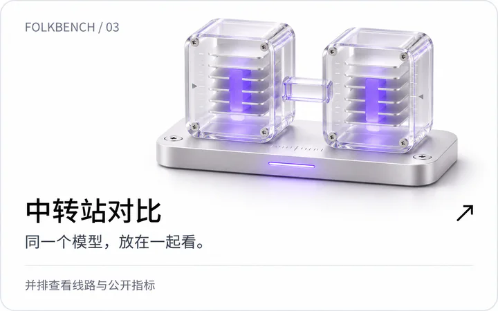
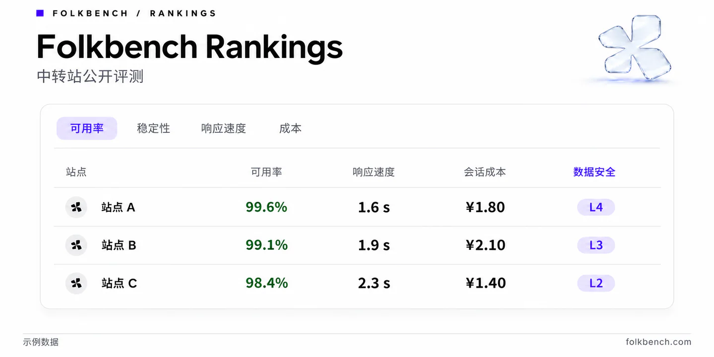
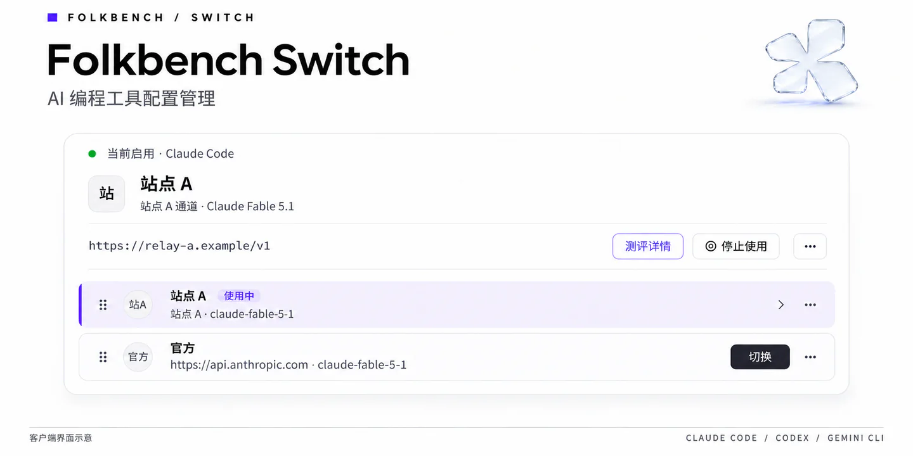

 

**[查看榜单](https://folkbench.com/rankings?utm_source=github&utm_medium=readme&utm_campaign=main-repo&utm_content=entry-rankings-2)** · **[降智监控](https://folkbench.com/arena?utm_source=github&utm_medium=readme&utm_campaign=main-repo&utm_content=entry-arena-3)** · **[下载 Switch](https://github.com/Folkbench/folkbench/releases)**

[English](README.en.md) · [日本語](README.ja.md) · [Español](README.es.md) · [Русский](README.ru.md)

 

## 中转站推荐

以下中转站支持 Folkbench 的持续运营。

<table>
<tr><td width="180"><a href="https://folkbench.com/go/modelflare?source=readme"><picture><source media="(prefers-color-scheme: dark)" srcset="docs/images/sponsors/modelflare-dark.png"></picture></a></td><td><a href="https://folkbench.com/go/modelflare?source=readme">Modelflare</a> Modelflare站点是由美国 Havenbyte LLC 运营，支持 GPT、Claude、Gemini、Grok 等主流模型和常用兼容协议，同时也支持 40 多种图片及视频模型。API Key 可以配置有序回退，一把 API Key 可以调用多个模型，Key 还可以设置备用分组，并且从请求日志里能看到状态、延迟、Token 和实际费用。  缓存补偿是这个站的另一个亮点：部分 OpenAI 价格优先、稳定和高级分组分别提供每日 65%、75%、85% 的缓存命中率保障，对于符合条件的api请求如果未达到缓存命中率，平台会给予对应补充。  站点目前也有首次充值解锁特惠分组的活动，单笔充值 US$20 后可解锁 0.015 倍率 GPT 特惠分组，解锁后 GPT-5.6-Sol 的价格大约是 ¥0.51（输入）/ ¥3.01（输出）/每百万 Token，并且没有使用上限限制。单笔充值 US$50 后可解锁 0.03 倍率 Claude 特惠分组。</td></tr>
<tr><td width="180"><a href="https://folkbench.com/go/fluxlane?source=readme"><picture><source media="(prefers-color-scheme: dark)" srcset="docs/images/sponsors/fluxlane-dark.png"></picture></a></td><td><a href="https://folkbench.com/go/fluxlane?source=readme">智流 FluxLane</a> 智流 FluxLane 是一个面向开发者与团队的 AI API 网关：提供满血且稳定的全球模型，支持 GPT、Claude、Gemini、Deepseek、GLM 等主流模型和全球主流模型厂商协议，平台提供策略路由与多线路容灾，方便国内团队长期接入与成本核算。面向国内企业/高校采购，可签订合同、对公转账，并提供发票、采购单等材料（具体以商务确认为准），公开模型能力检测报告，倍率低至0.1倍率，新人注册可领 2 美元体验额度。</td></tr>
<tr><td width="180"><a href="https://folkbench.com/go/merchant-955eb49b-34a?source=readme"><picture><source media="(prefers-color-scheme: dark)" srcset="docs/images/sponsors/sidrune-dark.png"></picture></a></td><td><a href="https://folkbench.com/go/merchant-955eb49b-34a?source=readme">Sidrune AI</a> 省心用Claude：Claude Max低至1.5折，另有14+Claude API线路，按量计费，支持开票及对公转账。</td></tr>
</table>

## AI API 中转站推荐与选站指南

> 排序遵循 Folkbench 站点规则，包含合作等级和运营加权。

### 中转站怎么选

1. **模型是否降级**：核对中转站的模型与分组，用相同任务比较回答、长文本处理和工具调用表现；能返回内容不代表模型符合预期。
2. **可用率**：查看中转站的统计时段与请求数量，同时留意空回复、超时和流式中断，小样本的高可用率不能代表长期表现。
3. **价格倍率**：比较中转站报价时对齐模型、币种与计价单位，分别看输入、输出和缓存费用，再核对实际扣费。
4. **退款政策**：先看中转站是否写清退款条件、手续费、处理时间与联系渠道；条款不明确时，先问清再充值。
5. **先小额试用**：用中转站的最低充值档或试用额度跑自己的常用任务，确认客户端兼容、响应与账单符合需求后再决定用量。

### 中转站充值风险

- **不要大额充值**：按近期用量控制中转站余额，避免为了折扣长期囤款。
- **留意跑路信号**：中转站突然高额返利、客服长期失联、退款受阻或频繁换域名时，先暂停追加充值并保存交易记录。
- **不要外贴 Key**：向中转站反馈故障或在 GitHub 提交问题时，遮盖 API Key、令牌和含凭据的截图。
- **留意数据去向**：提交内容会经过中转站；使用前确认数据保留和处理条款，避免发送不必要的敏感资料。

### 怎么检测一个中转站有没有降智

1. 记录中转站地址、模型、分组与测试时间，使用日常客户端检查流式响应和工具调用。
2. 选几道有明确预期的推理、代码和长文本任务，在中转站与官方接口上使用相同参数，多次比较结果。
3. 到 [Folkbench 中转站降智监控](https://folkbench.com/arena?utm_source=github&utm_medium=readme&utm_campaign=main-repo&utm_content=relay-guide-arena) 查看已有探针结果，并结合[评测方法](https://folkbench.com/methodology?utm_source=github&utm_medium=readme&utm_campaign=main-repo&utm_content=relay-guide-methodology)理解检测条件和局限。中转站的一次异常回答不足以证明模型被替换。

### Claude Code / Codex / Gemini CLI 中转站怎么选

Folkbench 帮你挑线路、配好客户端，不是自建代理教程。

- **Claude Code 中转站：** 先看 [Claude 中转站测评](https://folkbench.com/claude-zhongzhuanzhan-ceping?utm_source=github&utm_medium=readme&utm_campaign=main-repo&utm_content=tool-claude-ceping)，对比可用率、首字延迟和会话成本。
- **Codex 中转站：** 先看 [GPT / Codex 中转站测评](https://folkbench.com/gpt-codex-zhongzhuanzhan-ceping?utm_source=github&utm_medium=readme&utm_campaign=main-repo&utm_content=tool-codex-ceping)。
- **一键切换配置：** 选好线路后，用 [Folkbench Switch](https://folkbench.com/switch?utm_source=github&utm_medium=readme&utm_campaign=main-repo&utm_content=tool-switch) 在 Claude Code、Codex 和 Gemini CLI 之间切换中转站配置。
- **中转站横向对比：** 想把几家中转站放在一起看，用 [Folkbench 中转站对比](https://folkbench.com/stations/compare?utm_source=github&utm_medium=readme&utm_campaign=main-repo&utm_content=tool-compare) 并排比较。排序按站点规则展示，包含合作档位和运营加权。

### 中转站排行榜

查看 [Folkbench 中转站排行榜](https://folkbench.com/rankings?utm_source=github&utm_medium=readme&utm_campaign=main-repo&utm_content=relay-guide-rankings)，或阅读完整的[中转站推荐清单（GitHub）](https://github.com/magnus-minor/relay-api-recommend)，结合自己的模型需求与小额试用结果选择。

想先自己验一下手上的中转站？用 [Folkbench 实时检测](https://folkbench.com/evaluations/api-quality?utm_source=github&utm_medium=readme&utm_campaign=main-repo&utm_content=relay-guide-check)，填入你自己的 Key 检测一个接口：报告仅自己可见，密钥不保留。

## 今日公开快照

<!-- FOLKBENCH-BOARD:START -->
> 归档日期：2026-11-26 · 发布：2026-11-26 20:30:12（北京时间）· 快照：`public-11746bc346e14b021793baaa246cf4b5cce7d03625d00bd3cc82c9eba7ae6347`
> 排序沿用主站规则，包含合作档位与运营加分。本页提供公开快照，不是原始运行记录。

| 模型 | # | 中转站 | 综合 | 可用率 | 稳定性 | 输入 / 输出价 | 样本 |
| :-- | :-: | :-- | --: | --: | --: | :-- | --: |
| Claude Fable 5.1 | 1 | [Modelflare](https://folkbench.com/services/modelflare?utm_source=github&utm_medium=readme&utm_campaign=main-repo&utm_content=daily-board-claude-fable-5-1-r1) | 100.0% | 98.3% | 96.0% | ¥1.99 / 1M / ¥9.96 / 1M | 180 |
| claude-fable-5-1 | 2 | [破晓](https://folkbench.com/services/merchant-4cf2b788-920?utm_source=github&utm_medium=readme&utm_campaign=main-repo&utm_content=daily-board-claude-fable-5-1-r2) | 91.0% | 100.0% | 89.7% | ¥14.50 / 1M / ¥72.50 / 1M | 48 |
| Claude Fable 5.1 | 3 | [Apiporter](https://folkbench.com/services/apiporter?utm_source=github&utm_medium=readme&utm_campaign=main-repo&utm_content=daily-board-claude-fable-5-1-r3) | 85.4% | 95.7% | 83.3% | ¥20.00 / 1M / ¥100.00 / 1M | 47 |
| | | [完整 Claude Fable 5.1 榜单 →](https://folkbench.com/rankings/claude-fable-5-1?utm_source=github&utm_medium=readme&utm_campaign=main-repo&utm_content=daily-board-claude-fable-5-1-more) | | | | | |
| claude-haiku-5-5 | 1 | [Modelflare](https://folkbench.com/services/modelflare?utm_source=github&utm_medium=readme&utm_campaign=main-repo&utm_content=daily-board-claude-haiku-5-5-r1) | 100.0% | 97.6% | 95.3% | ¥0.17 / 1M / ¥0.83 / 1M | 168 |
| claude-haiku-5-5 | 2 | [Sidrune AI](https://folkbench.com/services/merchant-955eb49b-34a?utm_source=github&utm_medium=readme&utm_campaign=main-repo&utm_content=daily-board-claude-haiku-5-5-r2) | 91.9% | 100.0% | 91.7% | ¥0.10 / 1M / ¥0.50 / 1M | 48 |
| claude-haiku-5-5 | 3 | [open7x](https://folkbench.com/services/merchant-b03836a6-3ec?utm_source=github&utm_medium=readme&utm_campaign=main-repo&utm_content=daily-board-claude-haiku-5-5-r3) | — | 100.0% | — | $0.10 / 1M / $0.50 / 1M | 7 |
| | | [完整 claude-haiku-5-5 榜单 →](https://folkbench.com/rankings/claude-haiku-5-5?utm_source=github&utm_medium=readme&utm_campaign=main-repo&utm_content=daily-board-claude-haiku-5-5-more) | | | | | |
| Claude Opus 5 | 1 | [Modelflare](https://folkbench.com/services/modelflare?utm_source=github&utm_medium=readme&utm_campaign=main-repo&utm_content=daily-board-claude-opus-5-r1) | 100.0% | 97.9% | 94.7% | ¥1.00 / 1M / ¥4.98 / 1M | 140 |
| | | [完整 Claude Opus 5 榜单 →](https://folkbench.com/rankings/claude-opus-5?utm_source=github&utm_medium=readme&utm_campaign=main-repo&utm_content=daily-board-claude-opus-5-more) | | | | | |
| Claude Opus 5.5 | 1 | [Modelflare](https://folkbench.com/services/modelflare?utm_source=github&utm_medium=readme&utm_campaign=main-repo&utm_content=daily-board-claude-opus-5-5-r1) | 100.0% | 98.5% | 95.8% | ¥0.80 / 1M / ¥3.98 / 1M | 137 |
| Claude Opus 5.5 | 2 | [智流 FluxLane](https://folkbench.com/services/fluxlane?utm_source=github&utm_medium=readme&utm_campaign=main-repo&utm_content=daily-board-claude-opus-5-5-r2) | 94.2% | 93.8% | 78.2% | ¥4.80 / 1M / ¥24.00 / 1M | 48 |
| Claude Opus 5.5 | 3 | [IKunCode](https://folkbench.com/services/ikuncode?utm_source=github&utm_medium=readme&utm_campaign=main-repo&utm_content=daily-board-claude-opus-5-5-r3) | 94.1% | 77.3% | 49.4% | ¥4.00 / 1M / ¥20.00 / 1M | 44 |
| | | [完整 Claude Opus 5.5 榜单 →](https://folkbench.com/rankings/claude-opus-5-5?utm_source=github&utm_medium=readme&utm_campaign=main-repo&utm_content=daily-board-claude-opus-5-5-more) | | | | | |
| claude-sonnet-5-5 | 1 | [open7x](https://folkbench.com/services/merchant-b03836a6-3ec?utm_source=github&utm_medium=readme&utm_campaign=main-repo&utm_content=daily-board-claude-sonnet-5-5-r1) | — | 100.0% | — | $0.60 / 1M / $3.00 / 1M | 6 |
| | | [完整 claude-sonnet-5-5 榜单 →](https://folkbench.com/rankings/claude-sonnet-5-5?utm_source=github&utm_medium=readme&utm_campaign=main-repo&utm_content=daily-board-claude-sonnet-5-5-more) | | | | | |
| DeepSeek V4.1 Flash | 1 | [Modelflare](https://folkbench.com/services/modelflare?utm_source=github&utm_medium=readme&utm_campaign=main-repo&utm_content=daily-board-deepseek-v4-1-flash-r1) | 100.0% | 99.0% | 96.7% | ¥1.20 / 1M / ¥4.80 / 1M | 194 |
| deepseek-v4.1-flash | 2 | [aicode](https://folkbench.com/services/merchant-2b1bbef9-885?utm_source=github&utm_medium=readme&utm_campaign=main-repo&utm_content=daily-board-deepseek-v4-1-flash-r2) | 95.1% | 100.0% | 84.8% | ¥0.18 / 1M / ¥0.72 / 1M | 48 |
| DeepSeek V4.1 Flash | 3 | [智流 FluxLane](https://folkbench.com/services/fluxlane?utm_source=github&utm_medium=readme&utm_campaign=main-repo&utm_content=daily-board-deepseek-v4-1-flash-r3) | 94.2% | 89.6% | 77.5% | ¥0.90 / 1M / ¥3.60 / 1M | 48 |
| | | [完整 DeepSeek V4.1 Flash 榜单 →](https://folkbench.com/rankings/deepseek-v4-1-flash?utm_source=github&utm_medium=readme&utm_campaign=main-repo&utm_content=daily-board-deepseek-v4-1-flash-more) | | | | | |
| Gemini 3.8 Flash | 1 | [Modelflare](https://folkbench.com/services/modelflare?utm_source=github&utm_medium=readme&utm_campaign=main-repo&utm_content=daily-board-gemini-3-8-flash-r1) | 100.0% | 97.0% | 93.4% | ¥1.49 / 1M / ¥7.47 / 1M | 101 |
| | | [完整 Gemini 3.8 Flash 榜单 →](https://folkbench.com/rankings/gemini-3-8-flash?utm_source=github&utm_medium=readme&utm_campaign=main-repo&utm_content=daily-board-gemini-3-8-flash-more) | | | | | |
| GLM 5.3 | 1 | [Modelflare](https://folkbench.com/services/modelflare?utm_source=github&utm_medium=readme&utm_campaign=main-repo&utm_content=daily-board-glm-5-3-r1) | 100.0% | 98.4% | 95.7% | ¥4.00 / 1M / ¥14.00 / 1M | 184 |
| GLM 5.3 | 2 | [CheapAI](https://folkbench.com/services/cheapai?utm_source=github&utm_medium=readme&utm_campaign=main-repo&utm_content=daily-board-glm-5-3-r2) | 91.8% | 95.8% | 77.4% | ¥0.80 / 1M / ¥2.80 / 1M | 48 |
| | | [完整 GLM 5.3 榜单 →](https://folkbench.com/rankings/glm-5-3?utm_source=github&utm_medium=readme&utm_campaign=main-repo&utm_content=daily-board-glm-5-3-more) | | | | | |
| GPT 5.6 Terra | 1 | [Modelflare](https://folkbench.com/services/modelflare?utm_source=github&utm_medium=readme&utm_campaign=main-repo&utm_content=daily-board-gpt-5-6-terra-r1) | 100.0% | 97.7% | 94.8% | ¥0.20 / 1M / ¥1.20 / 1M | 170 |
| | | [完整 GPT 5.6 Terra 榜单 →](https://folkbench.com/rankings/gpt-5-6-terra?utm_source=github&utm_medium=readme&utm_campaign=main-repo&utm_content=daily-board-gpt-5-6-terra-more) | | | | | |
| GPT 6.1 Sol | 1 | [Modelflare](https://folkbench.com/services/modelflare?utm_source=github&utm_medium=readme&utm_campaign=main-repo&utm_content=daily-board-gpt-6-1-sol-r1) | 100.0% | 98.4% | 95.7% | ¥0.20 / 1M / ¥1.00 / 1M | 189 |
| gpt-6.1-sol | 2 | [Zashmodel](https://folkbench.com/services/merchant-5cf7678f-611?utm_source=github&utm_medium=readme&utm_campaign=main-repo&utm_content=daily-board-gpt-6-1-sol-r2) | 97.2% | 97.9% | 73.5% | — / — | 48 |
| gpt-6.1-sol | 3 | [Sidrune AI](https://folkbench.com/services/merchant-955eb49b-34a?utm_source=github&utm_medium=readme&utm_campaign=main-repo&utm_content=daily-board-gpt-6-1-sol-r3) | 91.9% | 97.9% | 77.7% | ¥0.20 / 1M / ¥1.00 / 1M | 48 |
| | | [完整 GPT 6.1 Sol 榜单 →](https://folkbench.com/rankings/gpt-6-1-sol?utm_source=github&utm_medium=readme&utm_campaign=main-repo&utm_content=daily-board-gpt-6-1-sol-more) | | | | | |
| GPT-6.1 Terra | 1 | [CheapAI](https://folkbench.com/services/cheapai?utm_source=github&utm_medium=readme&utm_campaign=main-repo&utm_content=daily-board-gpt-6-1-terra-r1) | 91.8% | 91.7% | 66.8% | ¥0.06 / 1M / ¥0.30 / 1M | 48 |
| | | [完整 GPT-6.1 Terra 榜单 →](https://folkbench.com/rankings/gpt-6-1-terra?utm_source=github&utm_medium=readme&utm_campaign=main-repo&utm_content=daily-board-gpt-6-1-terra-more) | | | | | |
| GPT-6.2 Astra | 1 | [CheapRouter](https://folkbench.com/services/cheaprouter?utm_source=github&utm_medium=readme&utm_campaign=main-repo&utm_content=daily-board-gpt-6-2-astra-r1) | 91.0% | 100.0% | 83.0% | ¥1.20 / 1M / ¥6.00 / 1M | 48 |
| GPT-6.2 Astra | 2 | [破晓](https://folkbench.com/services/merchant-4cf2b788-920?utm_source=github&utm_medium=readme&utm_campaign=main-repo&utm_content=daily-board-gpt-6-2-astra-r2) | 91.0% | 91.7% | 61.8% | ¥0.40 / 1M / ¥2.00 / 1M | 48 |
| | | [完整 GPT-6.2 Astra 榜单 →](https://folkbench.com/rankings/gpt-6-2-astra?utm_source=github&utm_medium=readme&utm_campaign=main-repo&utm_content=daily-board-gpt-6-2-astra-more) | | | | | |
| gpt-6.2-sol | 1 | [aicode](https://folkbench.com/services/merchant-2b1bbef9-885?utm_source=github&utm_medium=readme&utm_campaign=main-repo&utm_content=daily-board-gpt-6-2-sol-r1) | 95.1% | 100.0% | — | ¥0.18 / 1M / ¥1.80 / 1M | 8 |
| GPT-6.2 Sol | 2 | [CheapRouter](https://folkbench.com/services/cheaprouter?utm_source=github&utm_medium=readme&utm_campaign=main-repo&utm_content=daily-board-gpt-6-2-sol-r2) | 91.0% | 97.9% | 74.7% | ¥0.30 / 1M / ¥1.50 / 1M | 48 |
| GPT-6.2 Sol | 3 | [破晓](https://folkbench.com/services/merchant-4cf2b788-920?utm_source=github&utm_medium=readme&utm_campaign=main-repo&utm_content=daily-board-gpt-6-2-sol-r3) | 91.0% | 100.0% | 76.3% | ¥0.10 / 1M / ¥0.50 / 1M | 48 |
| | | [完整 gpt-6.2-sol 榜单 →](https://folkbench.com/rankings/gpt-6-2-sol?utm_source=github&utm_medium=readme&utm_campaign=main-repo&utm_content=daily-board-gpt-6-2-sol-more) | | | | | |
| GPT 6 Astra | 1 | [Modelflare](https://folkbench.com/services/modelflare?utm_source=github&utm_medium=readme&utm_campaign=main-repo&utm_content=daily-board-gpt-6-astra-r1) | 100.0% | 98.6% | 95.8% | ¥1.00 / 1M / ¥4.98 / 1M | 145 |
| gpt-6-astra | 2 | [Zashmodel](https://folkbench.com/services/merchant-5cf7678f-611?utm_source=github&utm_medium=readme&utm_campaign=main-repo&utm_content=daily-board-gpt-6-astra-r2) | 97.2% | 91.7% | 76.3% | — / — | 48 |
| GPT 6 Astra | 3 | [IKunCode](https://folkbench.com/services/ikuncode?utm_source=github&utm_medium=readme&utm_campaign=main-repo&utm_content=daily-board-gpt-6-astra-r3) | 94.1% | 93.2% | 67.4% | ¥7.00 / 1M / ¥35.00 / 1M | 44 |
| | | [完整 GPT 6 Astra 榜单 →](https://folkbench.com/rankings/gpt-6-astra?utm_source=github&utm_medium=readme&utm_campaign=main-repo&utm_content=daily-board-gpt-6-astra-more) | | | | | |
| Grok 4.6 | 1 | [Modelflare](https://folkbench.com/services/modelflare?utm_source=github&utm_medium=readme&utm_campaign=main-repo&utm_content=daily-board-grok-4-6-r1) | 100.0% | 98.1% | 95.3% | ¥0.13 / 1M / ¥0.40 / 1M | 157 |
| Grok 4.6 | 2 | [IKunCode](https://folkbench.com/services/ikuncode?utm_source=github&utm_medium=readme&utm_campaign=main-repo&utm_content=daily-board-grok-4-6-r2) | 94.1% | 100.0% | 88.0% | ¥0.60 / 1M / ¥1.80 / 1M | 44 |
| | | [完整 Grok 4.6 榜单 →](https://folkbench.com/rankings/grok-4-6?utm_source=github&utm_medium=readme&utm_campaign=main-repo&utm_content=daily-board-grok-4-6-more) | | | | | |
| Grok 4.7 | 1 | [Modelflare](https://folkbench.com/services/modelflare?utm_source=github&utm_medium=readme&utm_campaign=main-repo&utm_content=daily-board-grok-4-7-r1) | 100.0% | 97.2% | 94.3% | ¥1.46 / 1M / ¥4.38 / 1M | 145 |
| grok-4.7 | 2 | [IKunCode](https://folkbench.com/services/ikuncode?utm_source=github&utm_medium=readme&utm_campaign=main-repo&utm_content=daily-board-grok-4-7-r2) | 94.1% | 100.0% | 78.4% | ¥0.60 / 1M / ¥1.80 / 1M | 44 |
| | | [完整 Grok 4.7 榜单 →](https://folkbench.com/rankings/grok-4-7?utm_source=github&utm_medium=readme&utm_campaign=main-repo&utm_content=daily-board-grok-4-7-more) | | | | | |
| Qwen 3.8 Max | 1 | [Modelflare](https://folkbench.com/services/modelflare?utm_source=github&utm_medium=readme&utm_campaign=main-repo&utm_content=daily-board-qwen3-8-max-r1) | 100.0% | 98.2% | 95.5% | ¥9.60 / 1M / ¥28.80 / 1M | 170 |
| | | [完整 Qwen 3.8 Max 榜单 →](https://folkbench.com/rankings/qwen3-8-max?utm_source=github&utm_medium=readme&utm_campaign=main-repo&utm_content=daily-board-qwen3-8-max-more) | | | | | |

各模型的来源窗口与版本

| 模型 | 来源窗口 | 方法版本 | 来源快照 | 发布时间（北京时间） |
| :-- | :-- | :-- | :-- | :-- |
| claude-fable-5-1 | 2026-11-25 20:30:00/2026-11-26 20:30:00（北京时间） | folkbench-connectivity-v1 | rel-e82140d5-1795694423237 | 2026-11-26 20:00:23 |
| claude-fable-5-2 | catalog-only catalog cefc20a130bf8043 | folkbench-connectivity-v1 | rel-a3f26eaf-1795543480471 | 2026-11-25 02:04:40 |
| claude-haiku-5-5 | 2026-11-25 20:30:00/2026-11-26 20:30:00（北京时间） | folkbench-connectivity-v1 | rel-5d54ac67-1795694426148 | 2026-11-26 20:00:26 |
| claude-opus-5 | 2026-11-25 20:30:00/2026-11-26 20:30:00（北京时间） | folkbench-connectivity-v1 | rel-2fe8b1be-1795694428428 | 2026-11-26 20:00:28 |
| claude-opus-5-5 | 2026-11-25 20:30:00/2026-11-26 20:30:00（北京时间） | folkbench-connectivity-v1 | rel-dbd80724-1795694431490 | 2026-11-26 20:00:31 |
| claude-sonnet-5-5 | 2026-11-25 20:30:00/2026-11-26 20:30:00（北京时间） | folkbench-connectivity-v1 | rel-6233c051-1795543488418 | 2026-11-25 02:04:48 |
| deepseek-v4-1-flash | 2026-11-25 20:30:00/2026-11-26 20:30:00（北京时间） | folkbench-connectivity-v1 | rel-bdbc452b-1795694435690 | 2026-11-26 20:00:35 |
| gemini-3-8-flash | 2026-11-25 20:30:00/2026-11-26 20:30:00（北京时间） | folkbench-connectivity-v1 | rel-2e00bcdf-1795694458694 | 2026-11-26 20:00:58 |
| gemini-4-argon | catalog-only catalog 84044a2bde41e27d | folkbench-connectivity-v1 | rel-bcc2a6b4-1795543511157 | 2026-11-25 02:05:11 |
| gemini-4-carbon | catalog-only catalog 47f4c3d79232be37 | folkbench-connectivity-v1 | rel-ad12f1a5-1795543513168 | 2026-11-25 02:05:13 |
| gemini-4-hydrogen | catalog-only catalog 2927de52fd886783 | folkbench-connectivity-v1 | rel-556dd0fc-1795629869055 | 2026-11-26 02:04:29 |
| gemini-4-neon | catalog-only catalog 2b7c41b88d08605c | folkbench-connectivity-v1 | rel-adf672b8-1795629871139 | 2026-11-26 02:04:31 |
| glm-5-3 | 2026-11-25 20:30:00/2026-11-26 20:30:00（北京时间） | folkbench-connectivity-v1 | rel-75b3693a-1795694438015 | 2026-11-26 20:00:38 |
| gpt-5-6-terra | 2026-11-25 20:30:00/2026-11-26 20:30:00（北京时间） | folkbench-connectivity-v1 | rel-18bf4910-1795694440368 | 2026-11-26 20:00:40 |
| gpt-6-1-sol | 2026-11-25 20:30:00/2026-11-26 20:30:00（北京时间） | folkbench-connectivity-v1 | rel-553c9fd8-1795694447586 | 2026-11-26 20:00:47 |
| gpt-6-1-terra | 2026-11-25 20:30:00/2026-11-26 20:30:00（北京时间） | folkbench-connectivity-v1 | rel-1a8caf3f-1795694451346 | 2026-11-26 20:00:51 |
| gpt-6-2-astra | 2026-11-25 20:30:00/2026-11-26 20:30:00（北京时间） | folkbench-connectivity-v1 | rel-8e35dfe6-1795694453831 | 2026-11-26 20:00:53 |
| gpt-6-2-sol | 2026-11-25 20:30:00/2026-11-26 20:30:00（北京时间） | folkbench-connectivity-v1 | rel-16a6b5c6-1795694456304 | 2026-11-26 20:00:56 |
| gpt-6-astra | 2026-11-25 20:30:00/2026-11-26 20:30:00（北京时间） | folkbench-connectivity-v1 | rel-c466fbd8-1795694442793 | 2026-11-26 20:00:42 |
| grok-4-6 | 2026-11-25 20:30:00/2026-11-26 20:30:00（北京时间） | folkbench-connectivity-v1 | rel-ad7a463c-1795694463733 | 2026-11-26 20:01:03 |
| grok-4-7 | 2026-11-25 20:30:00/2026-11-26 20:30:00（北京时间） | folkbench-connectivity-v1 | rel-79a4bf3c-1795694466031 | 2026-11-26 20:01:06 |
| kimi-k3-1-pro | catalog-only catalog 172005db9e7472e9 | folkbench-connectivity-v1 | rel-4609039e-1795456996647 | 2026-11-24 02:03:16 |
| qwen3-8-max | 2026-11-25 20:30:00/2026-11-26 20:30:00（北京时间） | folkbench-connectivity-v1 | rel-3ab477c5-1795694470316 | 2026-11-26 20:01:10 |
| qwen4-max | catalog-only catalog ebc5382f8abe9fee | folkbench-connectivity-v1 | rel-8b87a7e6-1795629880435 | 2026-11-26 02:04:40 |

**探针汇总：快照收录 297 条探针结果，覆盖 18 家站点。** 汇总一致率：18968/25054（75.7%）。[查看公开结果 →](https://folkbench.com/arena?utm_source=github&utm_medium=readme&utm_campaign=main-repo&utm_content=daily-board-integrity)

[下载对应日期的公开快照](https://github.com/Folkbench/folkbench-data/tree/main/daily/2026/11/26) · [方法说明](https://folkbench.com/methodology?utm_source=github&utm_medium=readme&utm_campaign=main-repo&utm_content=daily-board-method) · [提交纠错](https://folkbench.com/corrections?utm_source=github&utm_medium=readme&utm_campaign=main-repo&utm_content=daily-board-corrections)
<!-- FOLKBENCH-BOARD:END -->

---

## Folkbench

Folkbench 把 AI 中转站的公开目录与榜单快照放在一起，让你按模型比较可用率、稳定性、响应速度和成本。选好线路后，用 **Folkbench Switch** 在本地管理 Claude Code、Codex、Gemini CLI 等工具的连接配置。

<table width="100%">
<tr>
<td width="33%" align="center" valign="top"></td>
<td width="33%" align="center" valign="top"></td>
<td width="33%" align="center" valign="top"></td>
</tr>
</table>

## 功能入口

| 你关心什么 | 从这里开始 |
| :--- | :--- |
| 哪些线路更常能用？ | [可用率榜](https://folkbench.com/rankings?utm_source=github&utm_medium=readme&utm_campaign=main-repo&utm_content=entry-rankings-7) |
| 长时间任务的表现怎样？ | [稳定性榜](https://folkbench.com/rankings/stability?utm_source=github&utm_medium=readme&utm_campaign=main-repo&utm_content=entry-rankings-stability-8) |
| 哪条线路响应更快？ | [响应速度榜](https://folkbench.com/rankings/latency?utm_source=github&utm_medium=readme&utm_campaign=main-repo&utm_content=entry-rankings-latency-9) |
| 一次编程会话大约花多少？ | [会话成本榜](https://folkbench.com/rankings/cost?utm_source=github&utm_medium=readme&utm_campaign=main-repo&utm_content=entry-rankings-cost-10) |
| 不同中转站的模型表现是否一致？ | [降智监控](https://folkbench.com/arena?utm_source=github&utm_medium=readme&utm_campaign=main-repo&utm_content=entry-arena-11) |
| 查找已收录中转站？ | [中转站目录](https://folkbench.com/stations?utm_source=github&utm_medium=readme&utm_campaign=main-repo&utm_content=entry-stations-12) |

### 降智监控

对同一模型、不同线路查看身份探针题的一致率、输入 Token、思考 Token 和模型指纹；有数据时也可查看缓存检测信息。一次回答或一个百分比不能单独证明模型被替换，结果需要结合检测条件与样本理解。

[打开监控 →](https://folkbench.com/arena?utm_source=github&utm_medium=readme&utm_campaign=main-repo&utm_content=entry-arena-13) · [阅读评测方法 →](https://folkbench.com/blog/did-the-model-get-dumber?utm_source=github&utm_medium=readme&utm_campaign=main-repo&utm_content=entry-blog-did-the-model-get-dumber-14)

<b>Folkbench Rankings</b>

 

示例数据；实际结果见线上榜单。

 

## Folkbench Switch

**把选好的线路，接入每天使用的工具。**

Switch 是基于 Tauri + Rust 的开源桌面客户端。保存服务商的 Base URL 与 API Key，预览配置差异，再应用到目标工具；需要时切换线路或恢复原有配置。

### 下载安装

<b><a href="https://github.com/Folkbench/folkbench/releases">下载 Switch Beta →</a></b> macOS · Apple Silicon / Intel　｜　Windows · x64

macOS 安装包为 `.dmg`，Windows 安装包为 `.exe`。

安装包与 SHA256 校验文件见 [Releases](https://github.com/Folkbench/folkbench/releases)。请按具体版本的发布说明选择安装包。

### 功能

| 能力 | 使用方式 |
| :--- | :--- |
| **服务商切换** | 保存多家服务的连接参数，将选择应用到目标工具。 |
| **配置差异预览** | 写入前检查变化，保留其他自定义设置；具体恢复能力以工具适配为准。 |
| **Codex 凭据保护** | 切至第三方服务时暂存官方 OAuth 凭据，切回时恢复。 |
| **组合档案** | 把各工具当前连接的线路保存为命名组合，一键整组切换。 |
| **托盘快速切换** | 在系统托盘切换组合或单个工具的服务，无需打开主窗口。 |
| **本机隐私脱敏** | 可选开启。请求经本机代理发出前，把 API Key、邮箱、公网 IP 与自定义敏感词替换为占位符，并在响应中还原；退出 Switch 时恢复直连。 |
| **公开线路发现** | 在客户端查看公开目录中的线路、可用率、状态窗口与价格。 |
| **本地用量估算** | 按会话查看 Token 消耗，并以参考单价估算成本。 |

Switch 在本地管理工具配置。公开目录、模型查询和服务商请求等联网功能仍需要网络；网站上的降智监控与缓存补偿信息不等于客户端已集成的功能。

<b>查看支持的工具与配置路径</b>

| 工具 | 配置文件 / 路径 | 说明 |
| :--- | :--- | :--- |
| **Claude Code** | `~/.claude/settings.json` | 自动写入 Base URL，智能处理 Token 与 API Key 凭据类型 |
| **Codex** | `~/.codex/config.toml` | 写入自定义 provider，暂存官方凭据，切回自动恢复 |
| **Gemini CLI** | `~/.gemini/.env` & `settings.json` | 同步写入环境变量与验证方式 |
| **Aider** | `~/.aider.conf.yml` | 写入模型与 API 端点参数 |
| **OpenCode** | `~/.config/opencode/` | 快速注入服务映射与认证 Key |
| **Kimi CLI** | `~/.kimi-code` / `~/.kimi` | 自动兼容新老版本目录 |
| **DeepSeek Harness** | `~/.dsh/` | 适配官方 CLI 环境 |
| **其他** | MiniMax Code、Qwen Code、Grok Build、Hermes、Pi 等 | 持续维护适配中 |

---

## 社区

- **反馈问题**：[提交 Issue](https://github.com/Folkbench/folkbench/issues)，附上复现步骤与版本信息；不要粘贴 API Key 或包含凭据的配置。
- **一起讨论**：[Telegram](https://t.me/+C_E8eL1ZevM4MTY9) · [QQ 群](https://qm.qq.com/q/71NzSTrPVK)（203286875）。
- **阅读与投稿**：[Folkbench 博客](https://folkbench.com/blog?utm_source=github&utm_medium=readme&utm_campaign=main-repo&utm_content=entry-blog-15)，包含评测方法、模型资料和读者投稿，现有内容覆盖 12 种语言。
- **了解客户端**：[Switch 开发说明](apps/switch/README.md)。

## 引用与徽章

每日归档见 [Folkbench Data](https://github.com/Folkbench/folkbench-data)，引用时请注明 Folkbench、归档日期和快照版本。数据许可见该仓库；公开快照不包含原始运行记录，不承诺可以复算。

快照徽章接口：`/badge/{station_slug}.svg?model={model_id}&metric=availability`。嵌入时将徽章链接到对应的主站档案页，并使用 `utm_source=github&utm_medium=badge`。

## 相关链接

- [中转站推荐清单（GitHub）](https://github.com/magnus-minor/relay-api-recommend)
- [中转站实时检测（用自己的 Key）](https://folkbench.com/evaluations/api-quality?utm_source=github&utm_medium=readme&utm_campaign=main-repo&utm_content=links-check)
- [Claude 中转站测评](https://folkbench.com/claude-zhongzhuanzhan-ceping?utm_source=github&utm_medium=readme&utm_campaign=main-repo&utm_content=links-claude-ceping)
- [GPT / Codex 中转站测评](https://folkbench.com/gpt-codex-zhongzhuanzhan-ceping?utm_source=github&utm_medium=readme&utm_campaign=main-repo&utm_content=links-codex-ceping)
- [中转站对比](https://folkbench.com/stations/compare?utm_source=github&utm_medium=readme&utm_campaign=main-repo&utm_content=links-compare)
- 公开快照子站（只读 [folkbench-data](https://github.com/Folkbench/folkbench-data) 归档；排序按站点规则，含合作档位与运营加权）：
  - [AI 中转站排行](https://folkbench.github.io/relay-rank/)：按模型的每日公开快照与历史名次
  - [中转站检测周报](https://folkbench.github.io/integrity-weekly/)：模型身份探针的每周汇总
  - [AI 中转站对比](https://ai-relay-bench.github.io/)：同一模型在各中转站的并排对比
  - [AI API 价格对比](https://aiapi-rank.github.io/)：中转站公开标价与官方参考价
  - [AI 中转站大全](https://ai-zhongzhuan.github.io/)：站点目录、公开资料与新手指南
  - [模型检测快照](https://ai-model-check.github.io/)：每日模型身份探针汇总

## 许可证

`apps/switch/` 下的客户端代码以 [Apache-2.0](apps/switch/LICENSE) 开源。博客文章、图片与品牌素材的许可范围见 [LICENSE.md](LICENSE.md)。

 <b>Folkbench</b> 在真实场景中衡量 AI 的价值。  <a href="https://folkbench.com/?utm_source=github&amp;utm_medium=readme&amp;utm_campaign=main-repo&amp;utm_content=entry-home-22">访问网站 ↗</a>　·　<a href="https://github.com/Folkbench/folkbench/releases">下载 Switch ↗</a>

