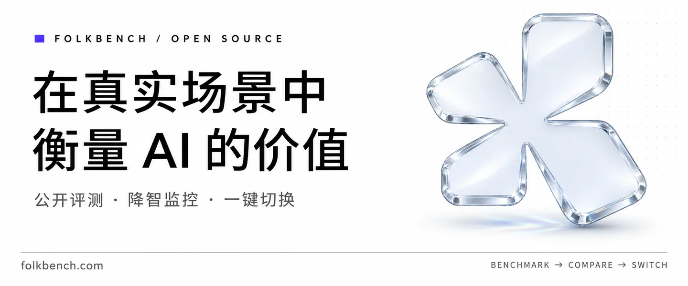
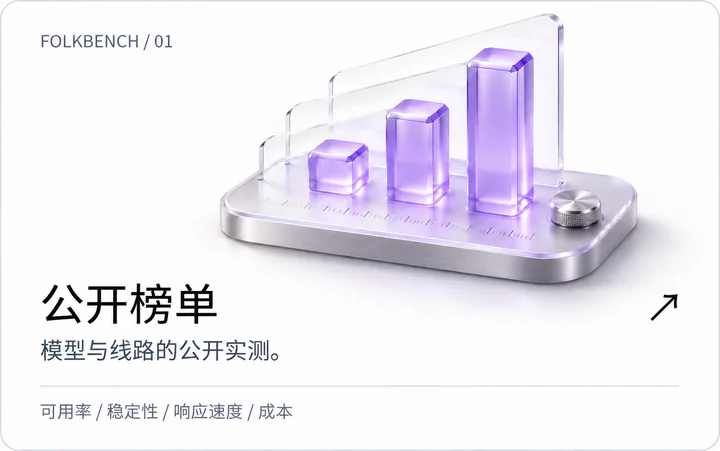
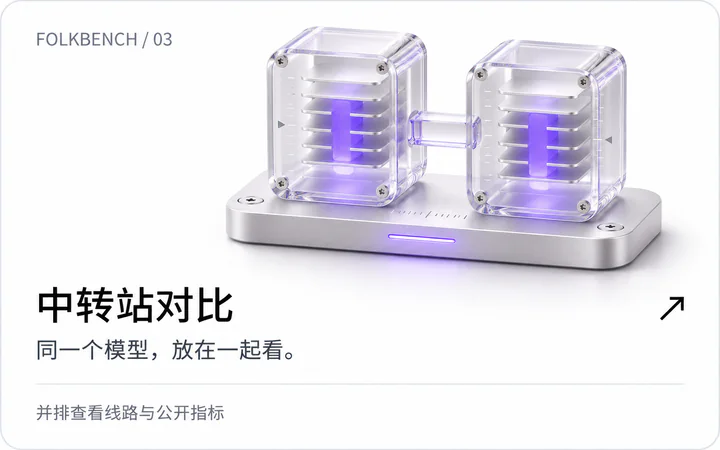
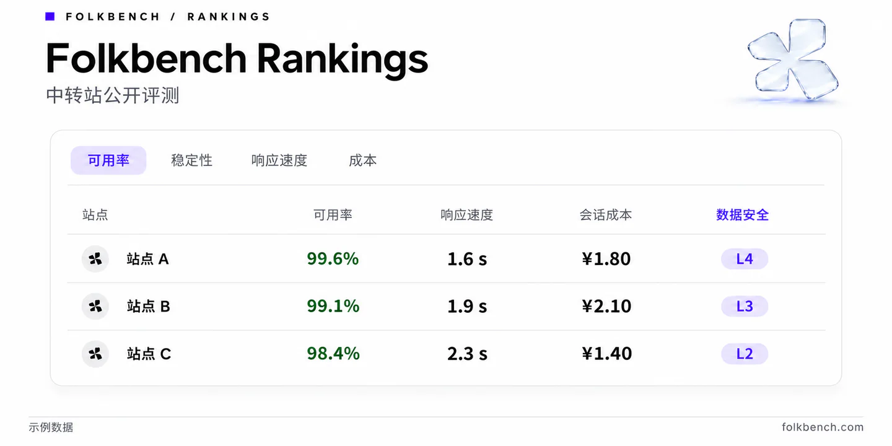
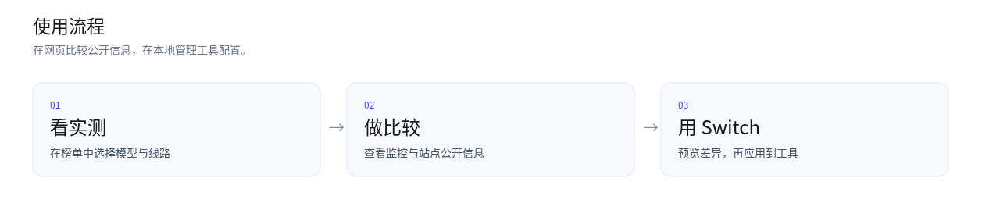
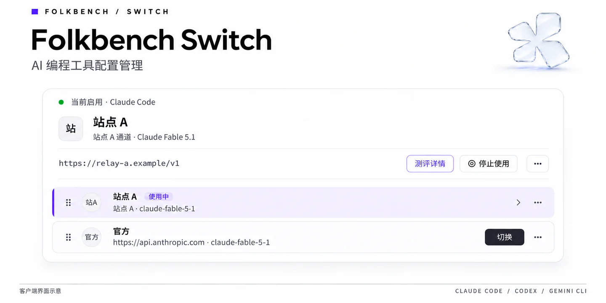

 

**[查看榜单](https://folkbench.com/rankings?utm_source=github&utm_campaign=readme)** · **[降智监控](https://folkbench.com/arena?utm_source=github&utm_campaign=readme)** · **[下载 Switch](https://github.com/Folkbench/folkbench/releases)**

[English](README.en.md) · [日本語](README.ja.md) · [Español](README.es.md)

 

## 赞助商

以下中转站支持 Folkbench 的持续评测。[成为赞助商 →](https://folkbench.com/vendor/login?utm_source=github&utm_campaign=readme)

<!-- 顶级赞助位预留：确定档位后在此放置单独一行大 Logo / Reserved for a top-tier sponsor once tiers exist -->

<!-- /go 跳转上线前的原始链接 / Original links before /go went live:
     Modelflare: https://modelflare.dev/sign-up?partner=TDN1QM6KKYX9&utm_source=folkbench&utm_medium=referral&utm_campaign=folkbench-blog-readme
     CheapAI: https://cheapai.info/sign-up?aff=TkeF&utm_source=folkbench&utm_medium=referral&utm_campaign=folkbench-blog-readme
     IKunCode: https://api.ikuncode.cc/sign-up?aff=QgPu&utm_source=folkbench&utm_medium=referral&utm_campaign=folkbench-blog-readme
     智流 FluxLane: https://folkbench.com/services/fluxlane?utm_source=github&utm_campaign=readme
-->

<table>
<tr>
<td width="200" align="center"><a href="https://folkbench.com/go/modelflare?source=readme"><picture><source media="(prefers-color-scheme: dark)" srcset="docs/images/sponsors/modelflare-dark.png"></picture></a></td>
<td><a href="https://folkbench.com/go/modelflare?source=readme"><b>Modelflare</b></a> Modelflare站点是由美国 Havenbyte LLC 运营，支持 GPT、Claude、Gemini、Grok 等主流模型和常用兼容协议，同时也支持 40 多种图片及视频模型。API Key 可以配置有序回退，一把 API Key 可以调用多个模型，Key 还可以设置备用分组，并且从请求日志里能看到状态、延迟、Token 和实际费用。  缓存补偿是这个站的另一个亮点：部分 OpenAI 价格优先、稳定和高级分组分别提供每日 65%、75%、85% 的缓存命中率保障，对于符合条件的api请求如果未达到缓存命中率，平台会给予对应补充。  站点目前也有首次充值解锁特惠分组的活动，单笔充值 US$20 后可解锁 0.015 倍率 GPT 特惠分组，解锁后 GPT-5.6-Sol 的价格大约是 ¥0.51（输入）/ ¥3.01（输出）/每百万 Token，并且没有使用上限限制。单笔充值 US$50 后可解锁 0.03 倍率 Claude 特惠分组。</td>
</tr>
<tr>
<td width="200" align="center"><a href="https://folkbench.com/go/cheapai?source=readme"><picture><source media="(prefers-color-scheme: dark)" srcset="docs/images/sponsors/cheapai-dark.png"></picture></a></td>
<td><a href="https://folkbench.com/go/cheapai?source=readme"><b>CheapAI</b></a> CheapAI字如其名，主打一个便宜，可以重点看特惠分组，价格确实压得很低。而且还有一个很有意思的动态倍率分组。按客服的介绍，这个分组会根据实时号池情况调整倍率。资源充足的时候价格可以更低，资源紧张时则会相应调整，在价格和可用性之间实时做一个平衡。  对于追求性价比的用户可以选择它们家折扣倍率较好的特惠分组，而对于追求稳定的用户可以选择稳定分组或 Pro 分组，站点也提供官 key 分组，能够覆盖不同使用需求。</td>
</tr>
<tr>
<td width="200" align="center"><a href="https://folkbench.com/go/ikuncode?source=readme"><picture><source media="(prefers-color-scheme: dark)" srcset="docs/images/sponsors/ikuncode-dark.png"></picture></a></td>
<td><a href="https://folkbench.com/go/ikuncode?source=readme"><b>IKunCode</b></a> IKunCode对于各个编程工具接入的支持比较好，Claude Code、Codex 和 Gemini CLI 都有单独支持，售后以及咨询渠道渠道做得比较全，官网公开了客服邮箱、QQ 群和 Telegram，人工客服服务贴心，很适合新手上路。</td>
</tr>
<tr>
<td width="200" align="center"><a href="https://folkbench.com/go/fluxlane?source=readme"><picture><source media="(prefers-color-scheme: dark)" srcset="docs/images/sponsors/fluxlane-dark.png"></picture></a></td>
<td><a href="https://folkbench.com/go/fluxlane?source=readme"><b>智流 FluxLane</b></a> 智流 FluxLane 是一个面向开发者与团队的 AI API 网关：提供满血且稳定的全球模型，支持 GPT、Claude、Gemini、Deepseek、GLM 等主流模型和全球主流模型厂商协议，平台提供策略路由与多线路容灾，方便国内团队长期接入与成本核算。面向国内企业/高校采购，可签订合同、对公转账，并提供发票、采购单等材料（具体以商务确认为准），公开模型能力检测报告，倍率低至0.1倍率，新人注册可领 2 美元体验额度。</td>
</tr>
</table>

---

## Folkbench

Folkbench 把 AI 中转站的公开评测放在一起，让你按模型比较可用率、稳定性、响应速度和成本。选好线路后，用 **Folkbench Switch** 在本地管理 Claude Code、Codex、Gemini CLI 等工具的连接配置。

<table width="100%">
<tr>
<td width="33%" align="center" valign="top"></td>
<td width="33%" align="center" valign="top"></td>
<td width="33%" align="center" valign="top"></td>
</tr>
</table>

## 功能入口

| 你关心什么 | 从这里开始 |
| :--- | :--- |
| 哪些线路更常能用？ | [可用率榜](https://folkbench.com/rankings?utm_source=github&utm_campaign=readme) |
| 长时间任务的表现怎样？ | [稳定性榜](https://folkbench.com/rankings/stability?utm_source=github&utm_campaign=readme) |
| 哪条线路响应更快？ | [响应速度榜](https://folkbench.com/rankings/latency?utm_source=github&utm_campaign=readme) |
| 一次编程会话大约花多少？ | [会话成本榜](https://folkbench.com/rankings/cost?utm_source=github&utm_campaign=readme) |
| 不同中转站的模型表现是否一致？ | [降智监控](https://folkbench.com/arena?utm_source=github&utm_campaign=readme) |
| 两家中转站怎么选？ | [中转站对比](https://folkbench.com/stations/compare?utm_source=github&utm_campaign=readme) |

### 降智监控

对同一模型、不同线路查看身份探针题的一致率、输入 Token、思考 Token 和模型指纹；有数据时也可查看缓存检测信息。一次回答或一个百分比不能单独证明模型被替换，结果需要结合检测条件与样本理解。

[打开监控 →](https://folkbench.com/arena?utm_source=github&utm_campaign=readme) · [阅读评测方法 →](https://folkbench.com/blog/did-the-model-get-dumber?utm_source=github&utm_campaign=readme)

<b>Folkbench Rankings</b>

 

示例数据；实际结果见线上榜单。

 

## Folkbench Switch

**把选好的线路，接入每天使用的工具。**

Switch 是基于 Tauri + Rust 的开源桌面客户端。保存服务商的 Base URL 与 API Key，预览配置差异，再应用到目标工具；需要时切换线路或恢复原有配置。

### 下载安装

<b><a href="https://github.com/Folkbench/folkbench/releases">下载 Switch Beta →</a></b> macOS · Apple Silicon / Intel　｜　Windows · x64

macOS 安装包为 `.dmg`，Windows 安装包为 `.exe`。

安装包与 SHA256 校验文件见 [Releases](https://github.com/Folkbench/folkbench/releases)。请按具体版本的发布说明选择安装包。

### 功能

| 能力 | 使用方式 |
| :--- | :--- |
| **服务商切换** | 保存多家服务的连接参数，将选择应用到目标工具。 |
| **配置差异预览** | 写入前检查变化，保留其他自定义设置；具体恢复能力以工具适配为准。 |
| **Codex 凭据保护** | 切至第三方服务时暂存官方 OAuth 凭据，切回时恢复。 |
| **公开线路发现** | 在客户端查看公开目录中的线路、可用率、状态窗口与价格。 |
| **本地用量估算** | 按会话查看 Token 消耗，并以参考单价估算成本。 |

Switch 在本地管理工具配置。公开目录、模型查询和服务商请求等联网功能仍需要网络；网站上的降智监控与缓存补偿信息不等于客户端已集成的功能。

<b>查看支持的工具与配置路径</b>

| 工具 | 配置文件 / 路径 | 说明 |
| :--- | :--- | :--- |
| **Claude Code** | `~/.claude/settings.json` | 自动写入 Base URL，智能处理 Token 与 API Key 凭据类型 |
| **Codex** | `~/.codex/config.toml` | 写入自定义 provider，暂存官方凭据，切回自动恢复 |
| **Gemini CLI** | `~/.gemini/.env` & `settings.json` | 同步写入环境变量与验证方式 |
| **Aider** | `~/.aider.conf.yml` | 写入模型与 API 端点参数 |
| **OpenCode** | `~/.config/opencode/` | 快速注入服务映射与认证 Key |
| **Kimi CLI** | `~/.kimi-code` / `~/.kimi` | 自动兼容新老版本目录 |
| **DeepSeek Harness** | `~/.dsh/` | 适配官方 CLI 环境 |
| **其他** | MiniMax Code、Qwen Code、Grok Build、Hermes、Pi 等 | 持续维护适配中 |

---

## 社区

- **反馈问题**：[提交 Issue](https://github.com/Folkbench/folkbench/issues)，附上复现步骤与版本信息；不要粘贴 API Key 或包含凭据的配置。
- **一起讨论**：[Telegram](https://t.me/+C_E8eL1ZevM4MTY9) · [QQ 群](https://qm.qq.com/q/71NzSTrPVK)（203286875）。
- **阅读与投稿**：[Folkbench 博客](https://folkbench.com/blog?utm_source=github&utm_campaign=readme)，包含评测方法、模型资料和读者投稿，现有内容覆盖 12 种语言。
- **了解客户端**：[Switch 开发说明](apps/switch/README.md)。

## 许可证

`apps/switch/` 下的客户端代码以 [Apache-2.0](apps/switch/LICENSE) 开源。博客文章、图片与品牌素材的许可范围见 [LICENSE.md](LICENSE.md)。

 <b>Folkbench</b> 在真实场景中衡量 AI 的价值。  <a href="https://folkbench.com/?utm_source=github&amp;utm_campaign=readme">访问网站 ↗</a>　·　<a href="https://github.com/Folkbench/folkbench/releases">下载 Switch ↗</a>

