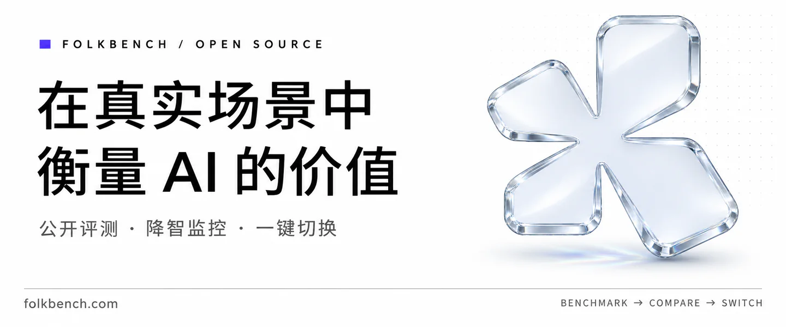
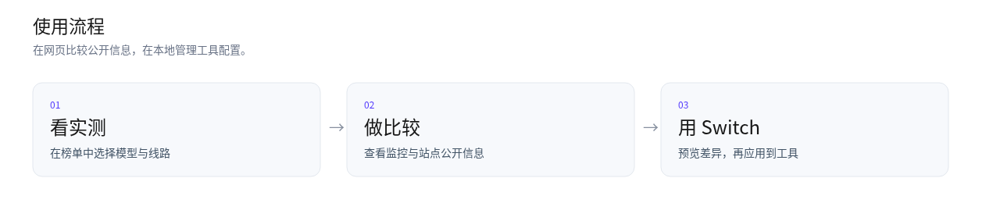

 

**[查看榜单](https://folkbench.com/rankings?utm_source=github&utm_medium=readme&utm_campaign=main-repo&utm_content=entry-rankings-2)** · **[降智监控](https://folkbench.com/arena?utm_source=github&utm_medium=readme&utm_campaign=main-repo&utm_content=entry-arena-3)** · **[下载 Switch](https://github.com/Folkbench/folkbench/releases)**

[English](README.en.md) · [日本語](README.ja.md) · [Español](README.es.md)

 

## 今日公开快照

<!-- FOLKBENCH-BOARD:START -->
首份每日公开快照尚未发布。排序沿用主站规则，包含合作档位与运营加分；部分数据为展示样本。
<!-- FOLKBENCH-BOARD:END -->

---

## Folkbench

Folkbench 把 AI 中转站的公开目录与榜单快照放在一起，让你按模型比较可用率、稳定性、响应速度和成本。选好线路后，用 **Folkbench Switch** 在本地管理 Claude Code、Codex、Gemini CLI 等工具的连接配置。

<table width="100%">
<tr>
<td width="33%" align="center" valign="top"></td>
<td width="33%" align="center" valign="top"></td>
<td width="33%" align="center" valign="top"></td>
</tr>
</table>

## 功能入口

| 你关心什么 | 从这里开始 |
| :--- | :--- |
| 哪些线路更常能用？ | [可用率榜](https://folkbench.com/rankings?utm_source=github&utm_medium=readme&utm_campaign=main-repo&utm_content=entry-rankings-7) |
| 长时间任务的表现怎样？ | [稳定性榜](https://folkbench.com/rankings/stability?utm_source=github&utm_medium=readme&utm_campaign=main-repo&utm_content=entry-rankings-stability-8) |
| 哪条线路响应更快？ | [响应速度榜](https://folkbench.com/rankings/latency?utm_source=github&utm_medium=readme&utm_campaign=main-repo&utm_content=entry-rankings-latency-9) |
| 一次编程会话大约花多少？ | [会话成本榜](https://folkbench.com/rankings/cost?utm_source=github&utm_medium=readme&utm_campaign=main-repo&utm_content=entry-rankings-cost-10) |
| 不同中转站的模型表现是否一致？ | [降智监控](https://folkbench.com/arena?utm_source=github&utm_medium=readme&utm_campaign=main-repo&utm_content=entry-arena-11) |
| 查找已收录中转站？ | [中转站目录](https://folkbench.com/stations?utm_source=github&utm_medium=readme&utm_campaign=main-repo&utm_content=entry-stations-12) |

### 降智监控

对同一模型、不同线路查看身份探针题的一致率、输入 Token、思考 Token 和模型指纹；有数据时也可查看缓存检测信息。一次回答或一个百分比不能单独证明模型被替换，结果需要结合检测条件与样本理解。

[打开监控 →](https://folkbench.com/arena?utm_source=github&utm_medium=readme&utm_campaign=main-repo&utm_content=entry-arena-13) · [阅读评测方法 →](https://folkbench.com/blog/did-the-model-get-dumber?utm_source=github&utm_medium=readme&utm_campaign=main-repo&utm_content=entry-blog-did-the-model-get-dumber-14)

<b>Folkbench Rankings</b>

 

示例数据；实际结果见线上榜单。

 

## Folkbench Switch

**把选好的线路，接入每天使用的工具。**

Switch 是基于 Tauri + Rust 的开源桌面客户端。保存服务商的 Base URL 与 API Key，预览配置差异，再应用到目标工具；需要时切换线路或恢复原有配置。

### 下载安装

<b><a href="https://github.com/Folkbench/folkbench/releases">下载 Switch Beta →</a></b> macOS · Apple Silicon / Intel　｜　Windows · x64

macOS 安装包为 `.dmg`，Windows 安装包为 `.exe`。

安装包与 SHA256 校验文件见 [Releases](https://github.com/Folkbench/folkbench/releases)。请按具体版本的发布说明选择安装包。

### 功能

| 能力 | 使用方式 |
| :--- | :--- |
| **服务商切换** | 保存多家服务的连接参数，将选择应用到目标工具。 |
| **配置差异预览** | 写入前检查变化，保留其他自定义设置；具体恢复能力以工具适配为准。 |
| **Codex 凭据保护** | 切至第三方服务时暂存官方 OAuth 凭据，切回时恢复。 |
| **公开线路发现** | 在客户端查看公开目录中的线路、可用率、状态窗口与价格。 |
| **本地用量估算** | 按会话查看 Token 消耗，并以参考单价估算成本。 |

Switch 在本地管理工具配置。公开目录、模型查询和服务商请求等联网功能仍需要网络；网站上的降智监控与缓存补偿信息不等于客户端已集成的功能。

<b>查看支持的工具与配置路径</b>

| 工具 | 配置文件 / 路径 | 说明 |
| :--- | :--- | :--- |
| **Claude Code** | `~/.claude/settings.json` | 自动写入 Base URL，智能处理 Token 与 API Key 凭据类型 |
| **Codex** | `~/.codex/config.toml` | 写入自定义 provider，暂存官方凭据，切回自动恢复 |
| **Gemini CLI** | `~/.gemini/.env` & `settings.json` | 同步写入环境变量与验证方式 |
| **Aider** | `~/.aider.conf.yml` | 写入模型与 API 端点参数 |
| **OpenCode** | `~/.config/opencode/` | 快速注入服务映射与认证 Key |
| **Kimi CLI** | `~/.kimi-code` / `~/.kimi` | 自动兼容新老版本目录 |
| **DeepSeek Harness** | `~/.dsh/` | 适配官方 CLI 环境 |
| **其他** | MiniMax Code、Qwen Code、Grok Build、Hermes、Pi 等 | 持续维护适配中 |

---

## 社区

- **反馈问题**：[提交 Issue](https://github.com/Folkbench/folkbench/issues)，附上复现步骤与版本信息；不要粘贴 API Key 或包含凭据的配置。
- **一起讨论**：[Telegram](https://t.me/+C_E8eL1ZevM4MTY9) · [QQ 群](https://qm.qq.com/q/71NzSTrPVK)（203286875）。
- **阅读与投稿**：[Folkbench 博客](https://folkbench.com/blog?utm_source=github&utm_medium=readme&utm_campaign=main-repo&utm_content=entry-blog-15)，包含评测方法、模型资料和读者投稿，现有内容覆盖 12 种语言。
- **了解客户端**：[Switch 开发说明](apps/switch/README.md)。

## 商业合作

以下中转站支持 Folkbench 的持续运营。榜单排序沿用主站现行规则，包含合作档位和运营加分。

<table>
<tr><td width="180"><a href="https://folkbench.com/services/modelflare?utm_source=github&amp;utm_medium=readme&amp;utm_campaign=main-repo&amp;utm_content=entry-services-modelflare-16"><picture><source media="(prefers-color-scheme: dark)" srcset="docs/images/sponsors/modelflare-dark.png"></picture></a></td><td><a href="https://folkbench.com/services/modelflare?utm_source=github&amp;utm_medium=readme&amp;utm_campaign=main-repo&amp;utm_content=entry-services-modelflare-17">Modelflare</a> 提供多模型 API 接入服务。</td></tr>
<tr><td width="180"><a href="https://folkbench.com/services/ikuncode?utm_source=github&amp;utm_medium=readme&amp;utm_campaign=main-repo&amp;utm_content=entry-services-ikuncode-18"><picture><source media="(prefers-color-scheme: dark)" srcset="docs/images/sponsors/ikuncode-dark.png"></picture></a></td><td><a href="https://folkbench.com/services/ikuncode?utm_source=github&amp;utm_medium=readme&amp;utm_campaign=main-repo&amp;utm_content=entry-services-ikuncode-19">IKunCode</a> 提供编程工具相关的模型 API 接入服务。</td></tr>
<tr><td width="180"><a href="https://folkbench.com/services/fluxlane?utm_source=github&amp;utm_medium=readme&amp;utm_campaign=main-repo&amp;utm_content=entry-services-fluxlane-20"><picture><source media="(prefers-color-scheme: dark)" srcset="docs/images/sponsors/fluxlane-dark.png"></picture></a></td><td><a href="https://folkbench.com/services/fluxlane?utm_source=github&amp;utm_medium=readme&amp;utm_campaign=main-repo&amp;utm_content=entry-services-fluxlane-21">智流 FluxLane</a> 提供 AI API 网关与多线路接入服务。</td></tr>
</table>

## 引用与徽章

每日归档见 [Folkbench Data](https://github.com/Folkbench/folkbench-data)，引用时请注明 Folkbench、归档日期和快照版本。数据许可见该仓库；公开快照不包含原始运行记录，不承诺可以复算。

快照徽章接口：`/badge/{station_slug}.svg?model={model_id}&metric=availability`。嵌入时将徽章链接到对应的主站档案页，并使用 `utm_source=github&utm_medium=badge`。

## 许可证

`apps/switch/` 下的客户端代码以 [Apache-2.0](apps/switch/LICENSE) 开源。博客文章、图片与品牌素材的许可范围见 [LICENSE.md](LICENSE.md)。

 <b>Folkbench</b> 在真实场景中衡量 AI 的价值。  <a href="https://folkbench.com/?utm_source=github&amp;utm_medium=readme&amp;utm_campaign=main-repo&amp;utm_content=entry-home-22">访问网站 ↗</a>　·　<a href="https://github.com/Folkbench/folkbench/releases">下载 Switch ↗</a>

